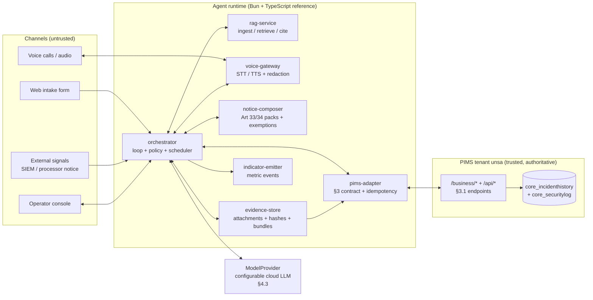
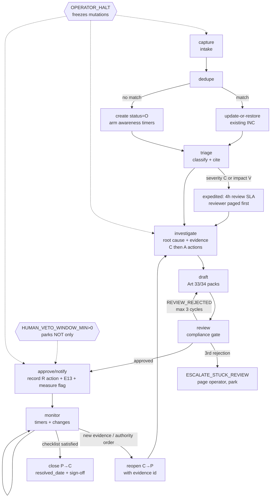
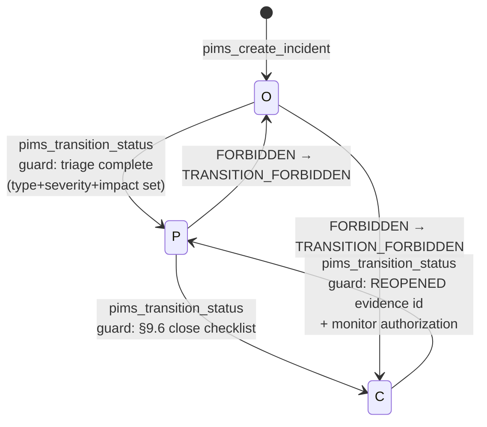
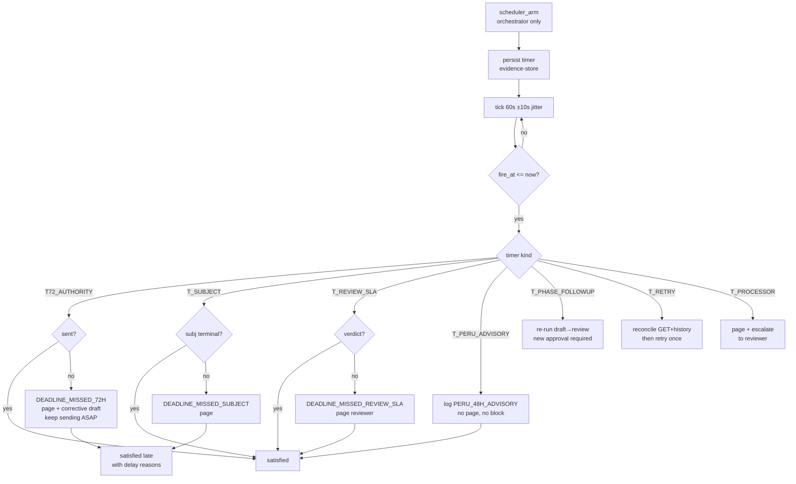

# Agente de Incidentes — Production Specification

| Field | Value |
|---|---|
| Document | Production specification, Agente de Incidentes (personal data breach / incident response) |
| Version | 1.0.0-final |
| Status | Final, buildable. No scaffolding, no deferred design. |
| Language | English. Spanish appears only inside verbatim literals (PIMS field labels, enum names, API messages, quoted sources). |
| Operator target | GESTITEL PIMS, tenant `unsa`, base `https://unsa.27k.pe` |
| Reference runtime | Bun + TypeScript (follows `flake.nix`, the sole toolchain pin). Tool, provider, and artifact contracts are language-agnostic. |
| Companion | `docs/incident-agent-capture/*.json` — 38 redacted live-API transcripts grounding §3. No other companion file exists. |

Conformance keywords: MUST, MUST NOT, REQUIRED, SHALL, SHALL NOT, SHOULD, SHOULD NOT, RECOMMENDED, MAY, OPTIONAL follow RFC 2119. `NEVER` = `MUST NOT`.

Every section states the ISO clause or control that requires it (template discipline from the course: state in which clause and annex control the norm requires the artifact). Any duty the workspace sources do not state is written as "not specified in workspace sources — agent MUST NOT assert it". The agent MUST NOT invent law, deadlines, fields, endpoints, roles, tools, or defaults beyond what this spec defines.

## 0. Scope and boundary

Required by: ISO 27701:2025 B.3.11 (plan and prepare incident management: processes, roles, responsibilities), B.3.12 (respond per documented procedures).

This agent owns the full closed loop for security and privacy incidents: intake, triage, root-cause investigation, containment/analysis/resolution actions, authority and data-subject notices, evidence, deadline monitoring, closure, and indicator emission. One-line boundary: this agent writes incidents plus incident actions plus linked audit action plans plus risk signals plus notices plus indicator events, and reads everything else.

In scope (MUST implement all):

1. Incident lifecycle on `core_incident` and its children (`core_incidentaction`, `core_incidentattachment`, `core_incidenthistory`, `core_incidentrecipient`), statuses `O/P/C`, via the §3 REST contract only.
2. GDPR Article 33 authority notification packs and Article 34 data-subject communications, including the Article 34(3) exemption evaluation, per §2.
3. Neuro-symbolic root-cause analysis with Tree-of-Thoughts (ToT) Bayesian hypothesis scoring, method selection (5-whys / fishbone / fault-tree), symbolic minimal cut-set counterfactual control simulation, multimodal forensic attachment inspection, evidence collection with SHA-256 hashing, and action sequencing `C*→A+→R`.
4. Corrective-action linkage: auto-create or link `core_auditfinding` (`classification=N`) plus `core_auditactionplan` rows for qualifying incidents.
5. Risk feedback: emit `core_riskevaluation` drafts (risk signals) into the open risk period for systemic root causes.
6. Deadline scheduling with Weibull survival hazard forecasting: 72-hour authority clock, processor immediacy, high-risk subject immediacy, expedited internal review SLA, provisional Peru 48-hour clock.
7. Multi-role orchestration with adversarial red-team constitutional multi-judge review, semantic-entropy hallucination gating, and split-conformal triage calibration (§5), autonomous loop (§6), Tri-Modal Agentic GraphRAG with HyDE, Personalized PageRank (PPR), and CRAG citations (§7), streaming voice intake with speaker diarization, acoustic anti-spoofing, paralinguistic urgency tagging, and dual-pass NER+regex redaction (§8).
8. Compliance artifacts (§10), security/privacy/safety (§11), reliability/observability/deployment (§12), configuration (§13), acceptance (§14).

Out of scope in one line: this agent MUST NOT write risk treatments, audit checklists, assets, documents, consents, ARCO-P cases, trainings, catalogs, licenses, users, or platform AI settings; it reads the first four as context and ignores the rest.

## 1. Definitions and conventions

Required by: B.3.11 (communicate processes, roles, responsibilities — shared vocabulary is part of that).

- PIMS: the GESTITEL Privacy Information Management System (Django 6 + `django-tenants`, PostgreSQL, REST API + React SPA).
- Incident: one `core_incident` row. There is no table named `ocurrencias` or `brechas`; `core_incident` is the breach/occurrence record.
- Breach: GDPR Art 4(12) "personal data breach" (see §2.1). An incident with `involves_personal_data=true` follows the full breach path; `false` follows the security-incident path (§9.1), which skips Art 33/34 but still runs C/A/R actions, history, and monitoring.
- Awareness (`awareness_at_utc`): the GDPR "having become aware" instant, defined once here: `detection_date` + `detection_time` in tenant local time converted to UTC when both present; `detection_date` at 00:00 tenant-local when only the date is present; `created_at` otherwise. All deadline clocks derive from this single definition.
- Authority: the competent supervisory authority (GDPR Art 55; Peru ANPD when the Peru row of §2.5 applies).
- PII principal / data subject / titular: the natural person the data identifies. Used interchangeably; artifacts use "data subject".
- DPO: Data Protection Officer (`dpo_contact_*` on the incident).
- `INC-###`: system-generated `incident_code`, UNIQUE, never hand-edited (Anexo_02 p.25).
- `O/P/C`: incident `status` codes — `O` Abierto (open), `P` En proceso (in process), `C` Cerrado (closed).
- `C/A/R`: `action_type` codes — `C` Contención (containment), `A` Análisis (analysis), `R` Resolución (resolution).
- Named errors: `UPPER_SNAKE` tokens defined exactly once in this spec. Every branch that can fail raises a named error; no branch merely logs. Unknown situations raise the nearest defined error with a `:detail` suffix; silent no-ops are forbidden.
- `unverified — confirm first`: marks provisional items only: ISO A-table numbers (§2.5), the Peru 48h row (§2.6), and the E21 risk-create response keys (§3.1). Nothing else in this spec carries this tag.
- Time: UTC everywhere internally (`timestamptz`); tenant-local (America/Lima) only at capture/display edges with explicit conversion.
- Language rule: spec prose is English. Code literals (`UA`, `notify`, `recipients_snapshot`), API messages (`"No hay destinatarios configurados para notificar."`), and quoted Spanish sources keep their original text.

## 2. Normative ground truth

All later sections cite this section; none re-derive law. Required by: B.3.11 (establish responsibilities and procedures for identifying, recording, and notifying PII breaches "taking into account the applicable legal requirements"), B.3.12 controller guidance (notifications, records, clear language).

### 2.1 Breach definition and risk framing (GDPR Art 4(12), Recitals 85–88)

 Art 4(12) (from `corpus/gdpr-full.txt:1030`): "‘personal data breach’ means a breach of security leading to the accidental or unlawful destruction, loss, alteration, unauthorised disclosure of, or access to, personal data transmitted, stored or otherwise processed".

 Recitals (from `corpus/gdpr-full.txt:454-469`, full lines):

- (85): "A personal data breach may, if not addressed in an appropriate and timely manner, result in physical, material or non-material damage to natural persons such as loss of control over their personal data or limitation of their rights, discrimination, identity theft or fraud, financial loss, unauthorised reversal of pseudonymisation, damage to reputation, loss of confidentiality of personal data protected by professional secrecy or any other significant economic or social disadvantage to the natural person concerned. Therefore, as soon as the controller becomes aware that a personal data breach has occurred, the controller should notify the personal data breach to the supervisory authority without undue delay and, where feasible, not later than 72 hours after having become aware of it, unless the controller is able to demonstrate, in accordance with the accountability principle, that the personal data breach is unlikely to result in a risk to the rights and freedoms of natural persons. Where such notification cannot be achieved within 72 hours, the reasons for the delay should accompany the notification and information may be provided in phases without undue further delay."
- (86): "The controller should communicate to the data subject a personal data breach, without undue delay, where that personal data breach is likely to result in a high risk to the rights and freedoms of the natural person in order to allow him or her to take the necessary precautions. The communication should describe the nature of the personal data breach as well as recommendations for the natural person concerned to mitigate potential adverse effects. Such communications to data subjects should be made as soon as reasonably feasible and in close cooperation with the supervisory authority, respecting guidance provided by it or by other relevant authorities such as law-enforcement authorities. For example, the need to mitigate an immediate risk of damage would call for prompt communication with data subjects whereas the need to implement appropriate measures against continuing or similar personal data breaches may justify more time for communication."
- (87): "It should be ascertained whether all appropriate technological protection and organisational measures have been implemented to establish immediately whether a personal data breach has taken place and to inform promptly the supervisory authority and the data subject. The fact that the notification was made without undue delay should be established taking into account in particular the nature and gravity of the personal data breach and its consequences and adverse effects for the data subject. Such notification may result in an intervention of the supervisory authority in accordance with its tasks and powers laid down in this Regulation."
- (88): "In setting detailed rules concerning the format and procedures applicable to the notification of personal data breaches, due consideration should be given to the circumstances of that breach, including whether or not personal data had been protected by appropriate technical protection measures, effectively limiting the likelihood of identity fraud or other forms of misuse. Moreover, such rules and procedures should take into account the legitimate interests of law-enforcement authorities where early disclosure could unnecessarily hamper the investigation of the circumstances of a personal data breach."

The agent's severity/impact classification (§9.2) and high-risk gate (§9.5) MUST use the (85)–(87) factors: nature, gravity, consequences, adverse effects, volume (subjects and records), sensitivity of data categories, and whether protective measures (e.g. encryption) limit misuse likelihood.

 ### 2.2 Authority notification (GDPR Art 33, verbatim from `corpus/gdpr-full.txt:2169-2201`)

Art 33(1): "In the case of a personal data breach, the controller shall without undue delay and, where feasible, not later than 72 hours after having become aware of it, notify the personal data breach to the supervisory authority competent in accordance with Article 55, unless the personal data breach is unlikely to result in a risk to the rights and freedoms of natural persons. Where the notification to the supervisory authority is not made within 72 hours, it shall be accompanied by reasons for the delay."

Art 33(2): "The processor shall notify the controller without undue delay after becoming aware of a personal data breach." No 72-hour figure applies to the processor leg.

Art 33(3): "The notification referred to in paragraph 1 shall at least:" — field checklist (each maps to an authority-pack field in §10.1):

| Item | Verbatim text | Pack field |
|---|---|---|
| (a) | "describe the nature of the personal data breach including where possible, the categories and approximate number of data subjects concerned and the categories and approximate number of personal data records concerned" | `nature` + `categories_subjects[]` + `approx_subjects` + `categories_records[]` + `approx_records` |
| (b) | "communicate the name and contact details of the data protection officer or other contact point where more information can be obtained" | `dpo_contact{name,email,phone}` |
| (c) | "describe the likely consequences of the personal data breach" | `likely_consequences` |
| (d) | "describe the measures taken or proposed to be taken by the controller to address the personal data breach, including, where appropriate, measures to mitigate its possible adverse effects" | `measures_taken[]` + `measures_proposed[]` |

Art 33(4): "Where, and in so far as, it is not possible to provide the information at the same time, the information may be provided in phases without undue further delay." The pack carries `phased:boolean`; when true, the agent MUST schedule follow-up phases as new timer tasks (§6.4), never drop them.

Art 33(5): "The controller shall document any personal data breaches, comprising the facts relating to the personal data breach, its effects and the remedial action taken. That documentation shall enable the supervisory authority to verify compliance with this Article." Satisfied by the evidence bundle (§10.3) plus `core_incidenthistory` plus the audit-trail export (§10.4). The agent MUST NOT close an incident while any of facts/effects/remedial-action is missing (§9.6).

Do not paraphrase away "where possible" / "where feasible": when a quantity is genuinely unknown at pack time, the agent writes the explicit marker `unknown` with reason code `PHASED_PENDING` and arms a follow-up phase; it MUST NOT guess numbers or omit the item.

 ### 2.3 Data-subject communication (GDPR Art 34, verbatim from `corpus/gdpr-full.txt:2203-2228`)

Art 34(1): "When the personal data breach is likely to result in a high risk to the rights and freedoms of natural persons, the controller shall communicate the personal data breach to the data subject without undue delay."

Art 34(2): "The communication to the data subject referred to in paragraph 1 of this Article shall describe in clear and plain language the nature of the personal data breach and contain at least the information and measures referred to in points (b), (c) and (d) of Article 33(3)." Note: item (a) (categories/numbers) is NOT required toward the subject; the agent MUST NOT include subject counts in subject notices unless the reviewer explicitly approves it as necessary context.

Art 34(3) exemptions — subject notice "shall not be required if any of the following conditions are met" (any single condition suffices; evaluation table in §9.5):

| Exemption | Verbatim text | Evidence the agent MUST hold |
|---|---|---|
| (a) | "the controller has implemented appropriate technical and organisational protection measures, and those measures were applied to the personal data affected by the personal data breach, in particular those that render the personal data unintelligible to any person who is not authorised to access it, such as encryption" | Protection-measure record: `security_measures_adopted` containing `encrypt_rest` or `encrypt_transit` applied to the affected data, plus an evidence attachment proving application (config export, key-scope statement). Reviewer approval REQUIRED. |
| (b) | "the controller has taken subsequent measures which ensure that the high risk to the rights and freedoms of data subjects referred to in paragraph 1 is no longer likely to materialise" | Post-breach measure record (`R` action + evidence) demonstrating risk elimination, e.g. revoked credentials + forced rotation + confirmed non-exfiltration. Reviewer approval REQUIRED. |
| (c) | "it would involve disproportionate effort. In such a case, there shall instead be a public communication or similar measure whereby the data subjects are informed in an equally effective manner." | Effort analysis (contactability count, cost/channel assessment) PLUS the public-communication artifact attached to the incident BEFORE the exemption is granted. Reviewer approval REQUIRED. |

Art 34(4): "If the controller has not already communicated the personal data breach to the data subject, the supervisory authority, having considered the likelihood of the personal data breach resulting in a high risk, may require it to do so or may decide that any of the conditions referred to in paragraph 3 are met." The agent MUST record an authority instruction as a `monitor` event that forces notice-state re-evaluation (§6.3); an authority order to notify overrides a granted (a)/(b)/(c) exemption.

### 2.4 Timeline table

| Rule | Deadline | Clock starts | Source |
|---|---|---|---|
| Controller → authority | Without undue delay; where feasible ≤ 72h. Late notice MUST carry delay reasons. | `awareness_at_utc` (§1) | Art 33(1) |
| Processor → controller | Without undue delay (no hour figure). | Processor awareness (received as intake signal; recorded as `detection_*` when the agent learns it) | Art 33(2) |
| Phased authority updates | Without undue further delay. | Each phase armed at pack time | Art 33(4) |
| Controller → subject (high risk) | Without undue delay, clear and plain language, content (b)+(c)+(d). | High-risk determination (§9.5) | Art 34(1)–(2) |
| Documentation | Complete facts/effects/remedial record, verifiable. | Continuous; MUST be complete before close | Art 33(5) |
| Expedited internal review | 4h internal SLA (agent policy, not GDPR). | `severity=C` or `impact=V` classification | §9.2 (B.3.12 timely response) |
| Peru ANPD (`unverified — confirm first` per §2.6) | 48h advisory only | `awareness_at_utc` | §2.6; MUST NOT be asserted as law |

### 2.5 ISO 27701:2025 controls and clauses

Source: workspace `ISO 27701-2025_ocr.pdf` OCR'd during spec authoring (`ocrmypdf --force-ocr`, then `pdftotext -layout`). The B-clause text below is verbatim from the OCR layer. The A-table numbers (A.3.11, A.3.12) come from the standard's own 2019↔2025 crosswalk tables inside the same PDF (lines mapping `A.3.11 ↔ 6.13.1.4 Assessment and decision on information security events` and `A.3.12 ↔ 6.13.1.5 Response to information security incidents`); the A-table body pages OCR'd poorly, so the A numbers are `unverified — confirm first` against a searchable copy before build. Contingency: replace numbers from the instructor's searchable copy; tool, state, and timer design are number-independent and do not change.

B.3.11 "Information security incident management planning and preparation" — Control: "The organization should plan and prepare for managing information security incidents related to PII processing by defining, establishing and communicating incident management processes, roles and responsibilities." Implementation guidance: "As part of the overall information security incident management process, the organization should establish responsibilities and procedures for identifying and recording breaches of PII. Additionally, the organization should establish responsibilities and procedures related to notifying relevant parties of PII breaches (including the timing of such notifications) and the disclosure to authorities, taking into account the applicable legal requirements." Plus: "Some jurisdictions impose specific regulations regarding breach responses, including notification. Organizations operating in these jurisdictions should ensure that they are aware of, and document how they comply with, these regulations." Requires: §§5 (roles), 6 (processes/timing), 9 (identification/recording), 2.6 (jurisdiction table).

B.3.12 "Response to information security incidents" — Control: "Responses to information security incidents related to PII processing should be according to the documented procedures." Controller guidance: "An incident that involves PII should trigger a review by the organization, as part of its information security incident management process, to determine if a breach involving PII that requires a response has taken place. An event does not necessarily trigger such a review." NOTE1 lists non-trigger examples (pings, broadcast attacks, port scans, unsuccessful log-on attempts, denial of service attacks, packet sniffing). "When a breach of PII has occurred, response procedures should include relevant notifications and records." NOTE2 notification content: "a contact point where more information can be obtained; a description of and the likely consequences of the breach; a description of the breach including the number of individuals concerned as well as the number of records concerned; measures taken or planned to be taken." Record content: "a description of the incident; the time period; the consequences of the incident; the name of the reporter; to whom the incident was reported; the steps taken to resolve the incident (including the person in charge and the data recovered); the fact that the incident resulted in unavailability, loss, disclosure or alteration of PII", plus "a description of the PII compromised, if known" and, if notifications were used, "the steps taken to notify PII principals, regulatory agencies or customers". Processor guidance: "Provisions covering the notification of a breach involving PII should form part of the contract between the organization and the customer. The contract should specify how the organization will provide the information necessary for the customer to fulfil their obligation to notify relevant authorities." Requires: §§6/9 (review gate deciding event-vs-breach), §10 (notification + record schemas carry every listed element).

A.3.11 (`unverified — confirm first`): "Assessment and decision on information security events" — the triage gate. Requires: §9.2.

A.3.12 (`unverified — confirm first`): "Response to information security incidents" — the response execution. Requires: §§9.3–9.6.

6.1.3 Privacy risk treatment: "define and apply a privacy risk treatment process … by: a) selecting appropriate privacy risk treatment options …; b) determining all controls necessary …; c) identifying and documenting the information security programme … (minimum list includes information security risk management, policies, organization, HR security, asset management, access control, operations security, network security, development security, supplier management, incident management, continuity, reviews, cryptography, physical/environmental); d) comparing … with those in Annex A …; e) producing a statement of applicability …". Requires: §9.4 risk-signal emission and SoA-gated control handling.

9.2 Internal audit: audit programme considering process importance and previous results; objectives/criteria/scope per audit; impartial auditors; results reported to relevant managers; documented evidence of programme and results. Requires: §9.4 audit linkage and §10.5 records.

9.3.2(d) Management review inputs: review MUST include "information on the privacy information management system performance, including trends in: nonconformities and corrective actions; monitoring and measurement results; audit results". Requires: §9.6 indicator events and §10.6 indicator schema.

10.2 Nonconformity and corrective action (verbatim steps): "a) react to the nonconformity, and as applicable: take action to control and correct it; deal with the consequences; b) evaluate the need for action to eliminate the cause(s) … by: reviewing the nonconformity; determining the causes; determining if similar nonconformities exist, or can potentially occur; c) implement any action needed; d) review the effectiveness of any corrective action taken; e) make changes to the privacy information management system, if necessary. Corrective actions shall be appropriate to the effects of the nonconformities encountered. Documented information shall be available as evidence of: the nature of the nonconformities and any subsequent actions taken; the results of any corrective action." Requires: §9.3 (a/b), §9.4 (c/e), §9.6 (d), §10 (evidence).

4.2 / 6.1.2 / 8.2: interested parties include supervisory authorities; privacy risk assessment covers consequences to PII principals; reassessment at planned intervals or on significant change. Requires: §9.5 high-risk gate and §6.3 monitor re-evaluation on significant change (new evidence, scope growth, authority instruction).

### 2.6 Jurisdiction table (configurable, see `JURISDICTION_DEADLINES_JSON` in §13)

| Jurisdiction | Authority duty | Subject duty | Status |
|---|---|---|---|
| EU_GDPR | Art 33: ≤72h + delay reasons + phases | Art 34: high-risk immediacy + (b)(c)(d) + exemptions (a)(b)(c) | Enforceable ground truth |
| PE_PDP | ANPD notification within 48h per Reglamento DS 016-2024-JUS art. 34 (`unverified — confirm first`: external vendor claim, Reglamento text absent from workspace) | Inform titular when rights affected — same unverified status | Provisional; agent schedules a non-blocking advisory timer only (§6.4), MUST NOT assert as law, MUST NOT block close on it |

Peru Ley 29733 applicability note (verified in workspace): `core_incident.involves_personal_data` is documented as "Indica si el incidente involucra datos personales (activa las obligaciones de la Ley 29733)" (Anexo_02 p.25). That is the only Peru-law statement grounded in workspace sources. Everything else about Peruvian procedure is not specified in workspace sources — agent MUST NOT assert it.

### 2.7 Clause/control → agent coverage matrix

Course rule (`data/class1.txt:22-150`): columns cláusulas / controles / agente, full coverage, "alta cohesión y bajo acoplamiento" (one agent owns one group; overlap only by force majeure). SoA exam rule (`data/class3.txt:244-330`): for every artifact, state in which clause and control the norm requires it.

| Clauses / controls | Owner | Handoff |
|---|---|---|
| A.3.11, A.3.12 (both `unverified — confirm first` per §2.5), B.3.11, B.3.12, 10.2 incident rows, 9.2/9.3 incident rows | Agente de Incidentes (this spec) | — |
| 6.1.3 risk treatment rows, `core_riskevaluation` lifecycle | Agente de Riesgos | This agent emits risk-signal drafts via §9.4; Riesgos owns scoring, treatment, verification |
| 9.2 audit programme rows, `core_audit` / `core_auditfinding` lifecycle | Agente de Auditoría | This agent creates `N` findings linked to its incidents; Auditoría owns audits, checklists, audit closure |
| 10.2 corrective-action rows, `core_auditactionplan` execution | Agente de Acciones Correctivas | This agent creates the action plan rows; Correctivas owns execution tracking and effectiveness review |
| 9.3.2(d) / 10.2 trend inputs | Agente de Indicadores | This agent emits indicator events (§10.6); Indicadores owns portals and management reporting |
| Asset/treatment context (`core_asset`, EIPD reads) | Agente de Datos y Procesos | Read-only from this agent; no writes |
| `HE` (human error) root-cause training triggers | Agente de Capacitación | This agent emits a training-recommendation indicator event; Capacitación owns planning and exams |
| Consent/policy reads for notice legal-basis context | Agente de Consentimiento, Agente de Gestión de Documentos | Read-only from this agent; no writes |

## 3. PIMS integration contract

Required by: B.3.11 (documented procedures for identifying/recording breaches — this section IS the recording procedure), B.3.12 (records sufficient for regulatory/forensic report), 6.1.3(c) (incident management inside the infosec programme).

No behavior in §§5–12 may reference a PIMS field, endpoint, enum, or error not defined in this section. Evidence: 38 live transcripts in `docs/incident-agent-capture/` (numbered below as `capture/NN`), the SQL dump `data/gestitel_base_de_datos.sql`, and Anexos 02/05. Passwords and tokens are redacted from all transcripts; the operator credential lives only in `data/site.md` and MUST NOT be copied into code, config, logs, or this spec's examples.

### 3.1 Endpoint table

Base URL `PIMS_BASE_URL` (default `https://unsa.27k.pe`). Auth: `Authorization: Bearer <access>` (JWT, `djangorestframework-simplejwt`, access 8h / refresh 1d). All list responses are paginated `{"count","next","previous","results":[]}`. Validation failures are HTTP 400 with `{"field":["message",...]}` (NOT 422 — verified `capture/22`). Missing objects are HTTP 404 `{"detail":"No <Model> matches the given query."}` (`capture/23`). Missing auth is HTTP 401 `{"detail":"Las credenciales de autenticación no se proveyeron."}` (`capture/24`).

| # | Method + path | Purpose | Required perm | Request keys | Response keys | Transcript |
|---|---|---|---|---|---|---|
| E01 | `POST /business/login/` | Obtain access+refresh JWT | none (public) | `username`, `password` | `access`, `refresh`, `user{id,username,is_platform_admin,platform_role,must_change_password,permissions[]}` | §3.3 |
| E02 | `POST /business/token/refresh/` | Rotate access token | none (refresh bearer in body) | `refresh` | `access` (access only, no new refresh) | `capture/34` |
| E03 | `GET /business/info/` | Tenant display name | none | — | `name` (e.g. `"UNSA"`) | `capture/09` |
| E04 | `GET /business/profile/` | Own user profile | authenticated | — | `username,first_name,last_name,email,is_platform_admin,is_external_advisor,platform_role` | `capture/33` |
| E05 | `GET /api/incidents/` | List incidents (paginated, filterable) | `view_incident` | query: `search,page,page_size,ordering,status,severity,incident_type` (verified `status`, `search/page/page_size/ordering` in bundle; `severity`/`incident_type` accepted by filter backend — if a key is ever ignored the API returns unfiltered 200, and the agent MUST client-side filter and log `PIMS_FILTER_IGNORED:<key>`) | `count,next,previous,results[incident]` | `capture/01`, `capture/37` |
| E06 | `POST /api/incidents/` | Create incident | `add_incident` | writable columns §3.4 (minimum: `title,involves_personal_data,incident_date,incident_type,status`, plus `affected_data_types[],security_measures_adopted[],affected_cid[]` which are NOT NULL jsonb — send `[]` when empty, never omit) | full incident incl. system `incident_code`, nested `actions[]`, `attachments[]`, `history[]`, `attachments_count`, `actions_count`, `created_by`, `updated_by` | `capture/10` → 201 |
| E07 | `GET /api/incidents/{id}/` | Incident detail | `view_incident` | — | full incident (57 keys, §3.4 + nested) | `capture/02` |
| E08 | `PATCH /api/incidents/{id}/` | Partial update incl. status transitions and nested `actions[]` (nested write verified `capture/11`; REPLACE-vs-MERGE on repeat sends untested — the adapter MUST run one startup probe on a throwaway incident: PATCH `[{C}]` then PATCH `[{A}]`, then GET: if only `[A]` remains, server REPLACEs and the adapter MUST read-modify-write every append; if `[C,A]` remain, server MERGEs and single-item PATCH is allowed; probe result logged `NESTED_PROBE:<replace|merge>` and baked into adapter behavior) | `change_incident` | any writable key; `actions:[{action_type,responsible,action_date,description,evidence}]` (`position` system-assigned) | full incident | `capture/11`, `capture/30` → 200 |
| E09 | `DELETE /api/incidents/{id}/` | Logical delete (`is_deleted=true`; UNIQUE stays occupied) | `delete_incident` (operator `grupob4` LACKS it — verified 403 `capture/25`; agent identity MUST be granted it per §3.3) | — | 204 empty on success | `capture/25` (403 shape) |
| E10 | `GET /api/incidents/{id}/history/` | Immutable timeline, newest first | `view_incident` | — | `[{id,event_type,event_type_label,changed_at,actor,changed_by,changed_by_name,description,recipients_snapshot}]` | `capture/03`, `capture/28` |
| E11 | `GET /api/incidents/{id}/attachments/` | List attachments | `view_incident` | — | `[{id,file,file_name,uploaded_at,uploaded_by,uploaded_by_name}]` (`file` is an authenticated tenant URL, never public) | `capture/29` |
| E12 | `POST /api/incidents/{id}/attachments/` | Upload attachment (`multipart/form-data`, field `file`) | `change_incident` (per §4.4 attachments remap) | `file` binary; types `jpg,jpeg,png,tif,bmp,pdf,doc,docx,txt` (bundle `ow` allowlist), ≤10 MB | 201 `[{id,file,file_name,uploaded_at,uploaded_by,uploaded_by_name}]` | `capture/12` |
| E13 | `POST /api/incidents/{id}/notify/` | Send notification email to ALL active `core_incidentrecipient` rows; appends `notified` history with `recipients_snapshot`. Empty body `{}`. Does NOT set `measure_reported_authorities` (verified null after notify — the agent MUST set it explicitly via E08). Fails 400 `{"detail":"No hay destinatarios configurados para notificar."}` when zero active recipients. | `change_incident` (per §4.4 notify remap) | `{}` (no per-call recipient override exists) | 200 full incident | `capture/13` (400), `capture/15` (200) |
| E14 | `GET /api/incident-recipients/` | List notify recipients | `view_incident` (recipients governed by Incidents perm, Anexo_05 §4.5) | — | paginated `[{id,email,label,is_active,created_at}]` | `capture/04` |
| E15 | `POST /api/incident-recipients/` | Create recipient | `add_incident` | `email` (UNIQUE), `label`, `is_active` | 201 recipient | `capture/14` |
| E16 | `DELETE /api/incident-recipients/{id}/` | Delete recipient (hard delete — table has no `is_deleted`) | `delete_incident` | — | 204 empty | `capture/27` |
| E17 | `GET /api/audits/` | List audits (filter `status`) | `view_audit` | query `status,...` | paginated audits with nested `checklist[]`, `findings[]`, `findings_count` | `capture/05`, `capture/38` |
| E18 | `POST /api/audits/` | Create audit | `add_audit` | `audit_type(I/E),name,status(P/R/C),scope,objective,start_date,end_date,lead_auditor,audit_team,involved_areas` (`audit_code` system `AUD-2026-###`, `progress` system) | 201 audit | `capture/16` |
| E19 | `PATCH /api/audits/{id}/` | Update audit incl. nested findings+actions (sub-key for plans is `actions`, NOT `action_plans` — verified `capture/17` ignored vs `capture/18` accepted; REPLACE-vs-MERGE on repeat sends untested — same startup-probe rule as E08, probe on a throwaway audit, result `NESTED_PROBE:audit:<replace|merge>`) | `change_audit` | `findings:[{classification,description,evidence,actions:[{action_plan,responsible,due_date,status,progress,closed_at}]}]` | 200 audit | `capture/17`, `capture/18`, `capture/31` |
| E20 | `GET /api/risk-evaluations/` | List risks (empty in tenant today: `{"count":0,...}`) | `view_riskevaluation` | — | paginated | `capture/06` |
| E21 | `POST /api/risk-evaluations/` | Create risk (DRAFT signal). Verified requirement: ≥1 asset (`assets` 400 otherwise, `capture/19`). Body MUST include `description,controlled_probability,controlled_impact` + `assets:[{asset:<id>}]` + optional `threat_code,vulnerability_code,threat,vulnerability,risk_owner,response_strategy,status`. `risk_code` system (`R-001` per period), scores system. `period_id` NOT accepted (server pins to active period; closed period → write rejected per dictionary). | `add_riskevaluation` | as above | 201 risk, response keys `unverified — confirm first` (tenant has zero assets so no successful create was capturable; agent MUST re-GET the created row and use live keys) | `capture/19` (400), `capture/21` (eligible empty) |
| E22 | `GET /api/risk-evaluations/catalogs/` | Risk methodology catalogs + periods | `view_riskevaluation` | — | `{periods[],current_period,threats[57],vulnerabilities[82],control_types[4],security_measure_types[3],estimated_times[3],asset_categories[7],asset_classifications[4],appraisal_bands[4],process_options,compliance_standard,annex_a_controls,applicable_annex_a_controls,active_matrix,risk_treatment_levels[],...,asset_scope_label}` (`capture/35`, 90 KB) | `capture/35` |
| E23 | `GET /api/risk-evaluations/eligible-assets/` | Assets in risk scope (`scope_label` e.g. `"ALTO y EXTREMO"`) | `view_riskevaluation` | — | paginated + `scope_label` (empty today) | `capture/21` |
| E24 | `GET /api/assets/` | Asset inventory sample (empty today) | `view_asset` | `page_size` | paginated | `capture/20` |
| E25 | `GET /api/dashboard/` | Executive KPIs (3 KPIs on `summary` tab: `risk_evaluation_coverage,compliance_global,arcop_ontime_rate`; each `{key,label,domain,domain_label,description,value,unit,direction,target,warning,has_target,status,has_data,reason,numerator,denominator,caption,is_default_target}`) | per-indicator module perms (unpermitted indicators are absent, never 403) | `tab` | `{tab,tabs[],generated_at,kpis[]}` | `capture/08` |
| E26 | `GET /api/annex-a-controls/meta/` | Integrated standard meta (27001:2022 + 27701:2025, 142 controls, groups A.5/A.6/A.7/...) | `view_gaprequirement` (SoA tab perm) | — | `{standard{code,label,annex_label,total_controls,is_superseded},groups[]}` | `capture/32` |

Pre-written capture commands (builder re-runs these if any row needs re-verification; tokens via env, never pasted):

```bash
ACCESS="$(bun -e 'console.log((await Bun.file("$HOME/.pims-token.json").json()).access)')"
curl -sS -H "Authorization: Bearer $ACCESS" 'https://unsa.27k.pe/api/incidents/?status=O'
curl -sS -H "Authorization: Bearer $ACCESS" 'https://unsa.27k.pe/api/incidents/1/history/'
curl -sS -H "Authorization: Bearer $ACCESS" 'https://unsa.27k.pe/api/risk-evaluations/catalogs/' | head -c 500
```

Risk creation against a tenant WITH assets is the one write the capture pass could not complete (tenant has zero assets, zero eligible assets); the E21 row is therefore half-verified (request contract proven by the 400, response keys pending). The builder MUST run one throwaway E21 create-then-close against a seeded tenant before relying on response-key names, without any spec redesign.

### 3.2 Data model

From `data/gestitel_base_de_datos.sql:1031-1220` (DDL) + Anexo_02 pp.22–28 (semantics). `AuditModel` = `created_at,created_by,updated_at,updated_by,is_deleted,deleted_at,deleted_by` at the API level, backed by DB columns `created_by_id,updated_by_id,deleted_by_id` (FK → `auth_user`, app-enforced PROTECT) on every parent table including `core_incident`. API field names are the exact column names (snake_case, verified in `capture/02`). The agent MUST NOT send `created_by_id/updated_by_id/deleted_by_id` (server-owned from the JWT session); it reads `created_by/updated_by` ids for attribution.

`core_incident` (48 domain columns below + 7 `AuditModel` columns = 55 DB columns; E07 GET returns 48 + `created_at,created_by,updated_at,updated_by` + `actions,attachments,history,attachments_count,actions_count` = 57 JSON keys; `incident_code` UNIQUE system `INC-001`; logical delete keeps UNIQUE occupied → reuse MUST restore, never re-insert):

| Column | Type | Null | Meaning |
|---|---|---|---|
| `id` | bigint PK | No | Internal id; URL identity for E07–E13 |
| `incident_code` | varchar(20) UNIQUE | No | System code, never hand-edited |
| `rep_document_number` | varchar(20) | Yes | Reporter representative: document number. PII. |
| `rep_document_expiry` | date | Yes | Reporter representative: document expiry. PII. |
| `rep_first_name` | varchar(100) | Yes | Reporter representative: first names. PII. |
| `rep_last_name_p` | varchar(100) | Yes | Reporter representative: paternal surname. PII. |
| `rep_last_name_m` | varchar(100) | Yes | Reporter representative: maternal surname. PII. |
| `rep_position` | varchar(100) | Yes | Reporter representative: position. PII. |
| `rep_phone` | varchar(20) | Yes | Reporter representative: mobile. PII. |
| `rep_email` | varchar(254) | Yes | Reporter representative: email. PII. |
| `entity_type` | varchar(1) | Yes | Reporting entity type: `R` Privada, `U` Pública |
| `entity_ruc` | varchar(11) | Yes | Reporting entity RUC |
| `entity_name` | varchar(200) | Yes | Reporting entity name |
| `entity_phone` | varchar(20) | Yes | Reporting entity phone |
| `entity_extension` | varchar(10) | Yes | Reporting entity extension |
| `entity_department` | varchar(50) | Yes | Reporting entity department (25 fixed values, bundle `Q2e`) |
| `entity_province` | varchar(100) | Yes | Reporting entity province |
| `entity_district` | varchar(100) | Yes | Reporting entity district |
| `involves_personal_data` | boolean | No | Whether PII is involved (activates Ley 29733 duties). REQUIRED on create. |
| `incident_date` | date | No | Date the incident occurred. REQUIRED on create. |
| `incident_time` | time | Yes | Time it occurred |
| `detection_date` | date | Yes | Date detected. Feeds `awareness_at_utc`. Guard: `detection_date >= incident_date` (bundle zod refine — server 400 otherwise). |
| `detection_time` | time | Yes | Time detected. Feeds `awareness_at_utc`. |
| `incident_type` | varchar(2) | No | REQUIRED. `UA/DL/MW/PH/DS/HE/DV/OT` (§3.5) |
| `status` | varchar(1) | No | REQUIRED. `O/P/C` (§3.5). Transitions via E08. |
| `severity` | varchar(1) | Yes | `L/M/H/C` (§3.5). Null until triage. |
| `impact` | varchar(1) | Yes | `L/M/H/V` (§3.5). Null until triage. |
| `title` | varchar(150) | No | REQUIRED on create |
| `description` | text | Yes | ≤1000 chars (dictionary; longer → server 400) |
| `reported_by` | varchar(150) | Yes | Who reported (B.3.12 record element) |
| `assigned_to` | varchar(150) | Yes | Assignee (B.3.12 "person in charge") |
| `affected_treatment` | varchar(200) | Yes | Affected data treatment/process |
| `dpo_contact_name` | varchar(150) | Yes | DPO contact name. PII. Art 33(3)(b) source. |
| `dpo_contact_email` | varchar(254) | Yes | DPO contact email. PII. Art 33(3)(b) source. |
| `dpo_contact_phone` | varchar(20) | Yes | DPO contact phone. PII. Art 33(3)(b) source. |
| `affected_data_types` | jsonb | No | REQUIRED (send `[]` if none). 12-code fixed catalog §3.5. Art 33(3)(a) source. |
| `num_affected_subjects` | integer | Yes | Estimated affected subjects. Art 33(3)(a) source. |
| `compromised_system` | varchar(255) | Yes | Compromised system (dedupe key part) |
| `affected_url` | varchar(500) | Yes | Affected URL (dedupe key part) |
| `evidence_refs` | text | Yes | Evidence references/links (citations stored here, §7.5) |
| `measure_updated_registry` | varchar(1) | Yes | Official-form measure Q: updated incident registry? `Y/N/U` |
| `measure_new_security` | varchar(1) | Yes | Official-form measure Q: adopted new security measures? `Y/N/U` |
| `measure_improved_policies` | varchar(1) | Yes | Official-form measure Q: improved procedures/policies? `Y/N/U` |
| `measure_considered_resolved` | varchar(1) | Yes | Official-form measure Q: considers incident resolved? `Y/N/U` |
| `measure_reported_authorities` | varchar(1) | Yes | Official-form measure Q: reported to authorities? `Y/N/U`. NOT auto-set by E13 — agent sets explicitly. |
| `security_measures_adopted` | jsonb | No | REQUIRED (send `[]` if none). 10-code fixed catalog §3.5. Art 33(3)(d) + 34(3)(a) source. |
| `resolved_date` | date | Yes | Resolution date (set on close) |
| `affected_cid` | jsonb | No | REQUIRED (send `[]` if none). `C/I/D` list §3.5 (B.3.12 "unavailability, loss, disclosure or alteration" element). |

Children (nested in detail responses; `position` system-assigned, 0-based):

- `core_incidentaction`: `id,incident_id FK CASCADE,action_type(C/A/R) NOT NULL,responsible,action_date,description NOT NULL,evidence,position NOT NULL`. Written ONLY via nested `actions[]` in E06/E08 (no standalone endpoint exists).
- `core_incidentattachment`: `id,incident_id FK CASCADE,file(path, authenticated tenant URL),file_name(system),uploaded_at,uploaded_by FK SET_NULL`. Written via E12; listed via E11. Only entity allowing multiple files.
- `core_incidenthistory`: `id,incident_id FK CASCADE,event_type(created/updated/notified/status_changed) NOT NULL,changed_at,actor,changed_by FK SET_NULL,description NOT NULL,recipients_snapshot`. Append-only (`save()` blocks UPDATE, `delete()` always fails — Anexo_04). Read via E10 or nested `history[]`.
- `core_incidentrecipient`: `id,email UNIQUE NOT NULL,label,is_active,created_at`. No incident FK — company-wide notify list. E13 mails ALL active rows. Managed via E14–E16.

Linked writers (this agent's corrective-action surface):

- `core_auditfinding`: `id,audit_id FK CASCADE,classification(N/O/M) NOT NULL,description NOT NULL,evidence(text only — no attachments in this version),position`. Written ONLY nested inside E18/E19 `findings[]`.
- `core_auditactionplan`: `id,finding_id FK CASCADE,action_plan NOT NULL,responsible,due_date,status(O/P/C),progress(0–100, feeds audit `progress` avg),closed_at,position`. Written ONLY nested as `actions[]` inside a finding (E19; key proven by `capture/18`).

Risk signal target: `core_riskevaluation` — `risk_code` system `R-001` UNIQUE per period, `status O/T/C`, `response_strategy M/A/T/E`, `period_id FK PROTECT` immutable after create (server pins to active period), scores/severity system-calculated, closed period = read-only (all writes rejected). Threat/vulnerability codes come from E22 catalogs (57 threats, 82 vulnerabilities across multiple two-letter families — exact codes read live from E22 at runtime, never hardcoded).

Read-only context: `core_asset` (E24), `core_annexacontrol` + `core_gapannexaassessment` (E26 + E22 `applicable_annex_a_controls`; `is_applicable` is the SoA gate — `risktreatment` accepts only applicable controls), `core_personaldataimpactassessment` / `core_personaldataoperation` (append-only, correction by annulling row — agent reads, never writes), dashboard KPIs (E25).

### 3.3 Auth sequence and required grants

Verified live. Login `POST /business/login/` with `{"username","password"}` → 200 `{"access","refresh","user"}`. Access JWT payload (decoded, `capture/token`): `{"token_type":"access","exp","iat","jti","user_id":"14","schema":"unsa","platform_role":null,"is_platform_admin":false}` — the `schema` claim MUST equal the connection schema or the API returns 401 (`TenantJWTAuthentication`, Anexo_05 §1.3). Refresh `POST /business/token/refresh/` with `{"refresh"}` → 200 `{"access"}` (access only; refresh is single-use-per-day — on refresh failure the agent MUST re-login via E01, never retry the same refresh). Request path per Anexo_05 §0: domain → `customer_domain` resolves `schema_name` → `SET search_path`; JWT schema check (401); license check (403 `LICENSE_EXPIRED`/`SERVICE_SUSPENDED`; only `/business/arcop/`, `/business/login|info/` exempt); `ModulePermission` (`view_<entidad>` REQUIRED even for GET; remaps: `notify→change_incident`, `attachments→change/view_*`, `versions→change/view_document`, `revoke→change_consent`, `approve→approve_document`); file gate `ProtectedMediaView` (`MEDIA_PERMISSION_REGISTRY["incidents/":"core.view_incident"]`, unknown prefix = deny, cross-tenant = 404 not 403); execute + immutable `core_securitylog` append (field names only, never values). Login throttle 5/min (429 `{"detail":...}` + frontend message "Demasiados intentos…"); password validators ≥8 with upper+lower+digit+symbol; `must_change_password` forces rotation (operator `grupob4` has it `false`, verified).

Agent service identity REQUIRED grants (least privilege; `view_securitylog` EXCLUDED — the agent MUST NOT read the security log):

`view/add/change/delete_incident`, `view/add/change/delete_incidentrecipient` (governed by incident perms), `view_asset`, `view/add/change_riskevaluation` (no delete — signals are drafts corrected by update), `view/add/change_audit`, `view_auditfinding` + finding/action write via audit perms, `view_gaprequirement` (SoA read), file perms `incidents/`, dashboard indicator reads via module perms. The capture operator (`grupob4`, Editor/`Oficial de protección de datos` template) demonstrably LACKS `delete_incident` (403 on E09, `capture/25`), `delete_audit` (403, `capture/26`), and risk-period config read (403 on `/api/risk-periods/`, `capture/07` — agent uses E22 `periods[]`/`current_period` instead, which IS permitted). The agent identity MUST be provisioned with the delete grants above; if provisioning is refused, the delegated-draft contingency applies ONLY to audit action plans (write approved drafts to evidence-store with `pending_grant:true`, auto-submit on grant — same schemas), while incident delete stays REQUIRED (no contingency: without it the agent cannot remove its own mistaken creates, violating Art 33(5) accuracy).

Session handling: tokens stored in memory only, never on disk; the SPA pattern (localStorage per-subdomain, auto-refresh on 401 via single-flight `pK()/hK()`, 403 license screen vs 403 permission toast "No tiene permiso para esta acción.") is informational — the agent implements §3.6 instead.

### 3.4 Transport rules

All writes go through the §3.1 endpoints so that `save()` calcs (`incident_code`/`audit_code`/`risk_code` sequences, scores, `progress` averages, `position` ordering), `clean()` catalog checks, logical delete, `core_incidenthistory` append, and `core_securitylog` append all fire. Direct SQL writes are FORBIDDEN: they bypass validations, calculations, history/securitylog, and logical-delete semantics (Anexo_04 §§1.3/2, Anexo_05 limitation 1). `timestamptz` UTC; encoding UTF8; PG ≥13 header / ≥14 deploy / reference PG 18.4; single DB `gestitel_db`, schemas `public` + per-tenant (`demo` in dump, `unsa` live). Nested arrays (E08 `actions[]`, E19 `findings[]`): behavior follows the §3.1 startup-probe result (`NESTED_PROBE`): on `replace` the adapter MUST read-modify-write (GET → append locally → PATCH full array); on `merge` single-item PATCH is allowed. Omitting a key leaves it. Sending `null` to clear a nullable field is UNTESTED against the live API — the adapter MUST verify per field on first use (PATCH `null`, re-GET, confirm cleared; log `NULL_CLEAR:<field>:<ok|rejected>`; on rejection use the field's empty equivalent — `""`/`[]` — or leave-and-flag `NULL_CLEAR_FAILED:<field>`). `description` ≤1000 chars on incidents. Attachment upload is multipart `file` field; download URLs are tenant-scoped authenticated URLs under `/media/tenants/<schema>/incidents/`. Exports containing PII MUST be preceded by the UI warning pattern and are logged as `export` events (Anexo_05 §7.2) — the agent logs `PIMS_EXPORT_PII_WARNED` before any bulk export and includes only redacted columns unless the reviewer approves full columns.

### 3.5 Enum and catalog maps

Single-code enums (verified: Anexo_02 + live detail + bundle maps `G2e/Z2e`):

| Field | Codes |
|---|---|
| `entity_type` | `R` Privada, `U` Pública |
| `incident_type` | `UA` Acceso no autorizado, `DL` Fuga o pérdida de datos, `MW` Malware o ransomware, `PH` Phishing o ingeniería social, `DS` Denegación de servicio, `HE` Error humano, `DV` Robo o pérdida de dispositivo, `OT` Otro |
| `status` (incident) | `O` Abierto, `P` En proceso, `C` Cerrado |
| `severity` | `L` Baja, `M` Media, `H` Alta, `C` Crítica |
| `impact` | `L` Bajo, `M` Medio, `H` Alto, `V` Muy alto |
| `measure_*` (5 fields) | `Y` Sí, `N` No, `U` Desconocido |
| `action_type` | `C` Contención, `A` Análisis, `R` Resolución |
| history `event_type` | `created` Creado, `updated` Actualizado, `notified` Notificación enviada, `status_changed` Cambio de estado |
| `audit_type` | `I` Interna, `E` Externa |
| audit `status` | `P` Planificada, `R` En curso, `C` Cerrada |
| `classification` | `N` No conformidad, `O` Observación, `M` Oportunidad de mejora |
| action-plan `status` | `O` Abierta, `P` En progreso, `C` Cerrada |
| risk `status` | `O` Abierta, `T` En tratamiento, `C` Cerrada |
| `response_strategy` | `M` Mitigar, `A` Aceptar, `T` Transferir, `E` Eliminar |
| `is_effective` | `P` Pendiente, `Y` Sí, `N` No |
| risk period `status` | `O` Abierto, `C` Cerrado (closed = read-only) |
| `entity_department` | 25 fixed values: Amazonas, Áncash, Apurímac, Arequipa, Ayacucho, Cajamarca, Callao, Cusco, Huancavelica, Huánuco, Ica, Junín, La Libertad, Lambayeque, Lima, Loreto, Madre de Dios, Moquegua, Pasco, Piura, Puno, San Martín, Tacna, Tumbes, Ucayali |

Fixed jsonb catalogs (recovered EXACTLY from the SPA bundle — these are NOT in the SQL dump; server validates codes in `clean()`):

- `affected_data_types` (12 codes, bundle `Y2e`): `names` Nombres y apellidos, `id_doc` Documento de identidad (DNI/CE), `address` Dirección domiciliaria, `phone` Teléfono, `email` Correo electrónico, `financial` Datos financieros/bancarios, `health` Datos de salud, `biometric` Datos biométricos, `geolocation` Datos de geolocalización, `credentials` Credenciales de acceso, `minors` Datos de menores de edad, `sensitive` Datos sensibles (origen racial, religioso, político, etc.).
- `security_measures_adopted` (10 codes, bundle `W2e`): `encrypt_rest` Cifrado en reposo, `encrypt_transit` Cifrado en tránsito, `mfa` Doble factor (MFA), `network_seg` Segmentación de red, `rbac` Control de acceso basado en roles, `siem` Monitoreo SIEM/detección de intrusos, `training` Capacitación a personal, `patching` Actualización de parches, `backups` Backups y plan de recuperación, `dlp` DLP (prevención de fuga de datos).
- `affected_cid` (bundle `X2e`): `C` Confidencialidad, `I` Integridad, `D` Disponibilidad.
- Attachment allowlist (bundle `ow`): `jpg,jpeg,png,tif,bmp,pdf,doc,docx,txt`; max 10 MB (bundle `cw=10`).
- Threat/vulnerability/control/measure-time codes: read live from E22 at runtime (`threats[57]`, `vulnerabilities[82]`, `control_types[4]`, `security_measure_types[3: TECNICO/...]`, `estimated_times[3: CORTO/...]`); MUST NOT be hardcoded (catalogs are tenant-configurable).

Unknown code received from PIMS → `PIMS_UNKNOWN_CODE:<field>:<code>`: halt the affected write, re-fetch E22/catalogs, and page the operator; MUST NOT guess or substitute.

### 3.6 HTTP error map

No catch-all fallback exists. Every HTTP outcome maps to exactly one named error and handling:

| HTTP | Meaning | Agent handling |
|---|---|---|
| 200/201/204 | Success (201 create/upload/recipient; 204 recipient delete; 200 otherwise) | Continue; record history pointer |
| 400 field errors `{"field":["msg"]}` | Validation (missing required, bad choice `"ZZ" no es una elección válida`, `detection_date < incident_date`, risk without assets, description >1000) | `PIMS_VALIDATION:<field>` → map each field error to re-prompt/re-extract (§9.1); MUST NOT guess enums or truncate silently (truncation needs reviewer approval) |
| 400 `{"Detail":"No hay destinatarios configurados para notificar."}` | E13 with zero active recipients | `NOTIFY_NO_RECIPIENTS` → block send, keep `approved` state, page operator (§9.5). MUST NOT send to empty/guessed list. |
| 401 missing/invalid/expired token, `schema` mismatch | Auth failure | Refresh once via E02; on refresh failure re-login via E01 once; else `PIMS_AUTH_FAILED` → halt loop, preserve timers/state, page operator |
| 401 `bad_authorization_header` | Malformed header (client bug) | `PIMS_CLIENT_BUG` → fail fast with the header shape logged (token redacted); MUST NOT retry |
| 403 `LICENSE_EXPIRED` / `SERVICE_SUSPENDED` | License gate | `PIMS_GATE_BLOCKED:<code>` → halt ALL writes, keep read-only monitor running, emit indicator event, page operator |
| 403 `{"Detail":"Usted no tiene permiso..."}` | Missing module perm (verified: delete without grant, risk-period config read) | `PIMS_PERMISSION_DENIED:<endpoint>` → for indicators: continue read-degraded and log; for notices/writes: halt the affected step and page (MUST NOT continue degraded for legal content) |
| 403 `DOCUMENT_LIMIT_REACHED` | Document quota (informational; agent uploads incident attachments, not documents — if ever returned, treat as gate) | `PIMS_GATE_BLOCKED:DOCUMENT_LIMIT` same as license gate |
| 404 `{"Detail":"No <Model> matches..."}` | Not found OR cross-tenant (indistinguishable by design) | `PIMS_NOT_FOUND:<model>:<id>` → treat as absent, MUST NOT retry as 403, MUST NOT probe other tenants |
| 409 | Conflict (concurrent `incident_code` sequence race; logical-delete UNIQUE collision on restore) | `PIMS_CONFLICT_CODE` → re-GET, then restore-or-regenerate per logical-delete rule (§3.2); single retry, else page |
| 429 | Throttle (login 5/min; ARCO 10/min n/a) | Exponential backoff 1s/5s/30s, max 3 attempts, then park with deadlines preserved → `PIMS_THROTTLED` |
| 5xx | Server failure | Retry idempotently (client `Idempotency-Key` header per mutation, §12.1) max 3 with 1s/5s/30s backoff, then `PIMS_UNAVAILABLE` with scheduler-held state; MUST NOT duplicate the mutation on recovery (reconcile via GET + history first) |
| Empty `results[]` | No rows (verified shapes: recipients, audits, risks, assets) | `PIMS_EMPTY_LIST:<resource>` — informational for reads; for notify recipients it is the `NOTIFY_NO_RECIPIENTS` precondition |
| Missing attachment URL / 404 on file GET | Dangling file | `PIMS_ATTACHMENT_MISSING:<id>` → mark evidence item `unverifiable`, continue with remaining evidence, page reviewer |
| Inactive recipient | `is_active=false` row | Excluded from E13 by the server; agent MUST NOT reactivate silently (reactivation needs operator approval) |
| Closed risk period | `status=C` or not `is_active` | `RISK_PERIOD_CLOSED` → queue signal with `period_name` + `queued_at`, never drop (§9.4) |
| Non-applicable Annex A control in treatment | `is_applicable=false` | `CONTROL_NOT_APPLICABLE` → block treatment field, keep signal, request SoA review (§9.4) |

Validation threshold rule: HTTP 400 shapes are Django-REST-framework standard (`{"field":[messages]}`, `{"Detail":...}`, `{"detail":...}` lowercase variant for 403). The agent MUST parse all three shapes; an unparseable error body → `PIMS_ERROR_SHAPE_UNKNOWN` with the raw body (redacted) attached, treated as retryable-once then `PIMS_UNAVAILABLE`.

## 4. System architecture

Required by: B.3.11 (define and communicate incident management processes, roles, responsibilities), 6.1.3(c) (incident management inside the infosec programme), B.3.12 (documented procedures drive responses).

### 4.1 Component diagram



### 4.2 Components and trust boundaries

| Component | Responsibility | Trust |
|---|---|---|
| `orchestrator` | Owns the §6 loop, policy evaluation, scheduler, leases, and all role dispatch. Sole component that calls tools. | Trusted core. MUST validate every tool result against §5 schemas; invalid result → `TOOL_RESULT_INVALID:<tool>` fail the step, never coerce. |
| `pims-adapter` | Exclusive PIMS gateway: auth/session (§3.3), endpoint calls (§3.1 E01–E26), error map (§3.6), idempotency keys, read-modify-write for nested REPLACE arrays, logical-delete restore logic, live E22/E23/E24/E26 catalog and asset resolution. | Trust boundary PIMS↔agent. MUST NOT accept PIMS data without schema validation; unknown code → `PIMS_UNKNOWN_CODE`. |
| `rag-service` | Corpus ingest with SHA-256 versioning, contextual chunk headers, Tri-Modal GraphRAG (Dense + BM25 + Normative Knowledge Graph), HyDE query expansion, CRAG self-grading, rerank, citation formatting, and the 10-query eval gate. | Trusted for retrieval; UNTRUSTED for content — every passage carries `doc_id:chunk:lines` and a non-normative flag where applicable; legal content without citation is rejected (§6.5). |
| `voice-gateway` | Streaming STT/TTS provider calls, VAD barge-in, paralinguistic stress/urgency prosody scoring, language handling (`es-PE` primary, `en` fallback), dual-pass NER+regex PII redaction before synthesis, audio-ref retention. | Untrusted input (audio). Transcript confidence <`VOICE_MIN_CONFIDENCE` → `VOICE_LOW_CONFIDENCE`. Raw audio MUST NOT enter prompts or logs. |
| `notice-composer` | Builds Art 33/34 packs from validated incident fields + RAG citations; runs the exemption decision tables and constitutional rubric pre-checks; produces drafts ONLY (never sends). | Trusted builder; output is inert until `compliance_reviewer` approves. |
| `evidence-store` | PostgreSQL with Drizzle ORM + blob staging: attachment bytes pre-upload, multimodal forensic scan reports, SHA-256 hashes, PII tags, bundle manifests, draft packs, leases, dedupe index, queued signals. | Trusted staging; MUST encrypt at rest (AES-256-GCM, key via env) and purge per retention (§13). |
| `indicator-emitter` | Emits metric events per §10.6 on every state change; feeds Agente de Indicadores and 9.3.2(d) inputs. | Fire-and-forget with local spool; emission failure → `INDICATOR_SPOOL_FULL` (spool 10k events, then oldest dropped with counter — the single allowed lossy path, counters preserved). |
| `operator-console` | Read-mostly UI: queue, incident timeline, drafts pending veto, audit trail view, kill-switch, grant/revoke recipient activation, capture re-run buttons. | Authenticated operators only (§11.1). Console actions are synchronous calls into `orchestrator`; console MUST NOT call PIMS directly. |

Strict data flow: `channel → orchestrator → tools → pims-adapter/evidence-store → history/securitylog`. The LLM (via `ModelProvider`) NEVER touches PIMS, the evidence bytes, or raw audio; it receives redacted context (§11.3) and returns structured tool calls / drafts that the orchestrator validates before any effect.

Runtime: Bun + TypeScript reference (only toolchain pin in `flake.nix`). All contracts in §§5/7/8/10/13 are language-agnostic JSON/HTTP; a Python runtime swaps only this chapter and §12 packaging.

### 4.3 ModelProvider abstraction (configurable cloud, never fixed)

Course privacy context (`class1.txt:442-482`) prefers on-prem ("pecera de vidrio"); the build decision (user override) is configurable cloud, mitigated by §11.3 redaction + zero raw PII in prompts + provider switchability. OpenRouter is ALLOWED as one provider row but MUST NOT be the only option and MUST NOT be hardcoded.

```typescript
interface ModelProvider {
  chat_json(args: {
    system: string; messages: Message[]; tools?: ToolSchema[];
    json_schema?: object;
    max_tokens: number; temperature: number; 
  }): Promise<{
    content: object; citations_requested: boolean;
    logprobs?: number[]; semantic_entropy?: number; conformal_score?: number;
  }>;
  vision_json(args: {
    system: string; image_or_pdf_ref: string; prompt: string;
    json_schema: object; max_tokens: number; temperature: number;
  }): Promise<{
    extracted_text_redacted: string; iocs: string[]; pii_detected: string[];
    encryption_proof_verified: boolean; tamper_score: number; layout_hashes: string[];
  }>;
  embed(args: { texts: string[] }): Promise<{ vectors: number[][] }>;
  rerank(args: { query: string; passages: Passage[] }): Promise<{ ranked: RankedPassage[] }>;
}
interface Message { role: "system"|"user"|"assistant"|"tool"; content: string; tool_call?: object; tool_result?: object }
```

Routing table (concrete values live ONLY in §13; this table fixes the routing RULES):

| Route | Used by | Rule |
|---|---|---|
| `REASONING_MODEL` | ToT investigation, symbolic cut-set simulation, drafting, adversarial constitutional review | Complex reasoning; temperature `TEMP_REASONING` (§13); `logprobs` + semantic-entropy gate (`MAX_SEMANTIC_ENTROPY`) + JSON-schema enforced |
| `FAST_MODEL` | classification, extraction, split-conformal triage, HyDE/CRAG | Latency-sensitive; temperature `TEMP_CLASSIFIER` (§13); `logprobs` + JSON-schema enforced |
| `VISION_MODEL` | multimodal forensic attachment inspection (`investigator`) | Multimodal OCR + visual PII bounding-box detection + ELA/metadata tamper score + Art 34(3)(a) proof check; temperature `TEMP_CLASSIFIER` (§13); local pre-redaction crop |
| `EMBEDDINGS_MODEL` | RAG ingest + query | Single model per corpus version; changing it REQUIRES full re-ingest (new corpus version) |
 | `RERANKER_MODEL` | RAG rerank stage | Cross-encoder or LLM-rank; score threshold §7.4 |
 | `chat_json` route selection | classification/HyDE/CRAG/decomposition vs ToT/drafting/review | `route` arg (`FAST_MODEL` = classification/HyDE/CRAG/decomposition; `REASONING_MODEL` = ToT/drafting/review); caller-supplied, never inferred from temperature |
 | `RERANKER_MODEL` provider `cohere` | RAG rerank stage via native API | `POST {endpoint}/v2/rerank` (`{query, documents, top_n}`, `top_n` bounded); explicit endpoint+model required in `RERANKER_MODEL`, missing → `MODEL_UNAVAILABLE:RERANKER_MODEL` |
| `STT_PROVIDER`/`STT_MODEL` | voice intake | Streaming-capable; word timestamps REQUIRED for slot-fill audit |
| `TTS_PROVIDER`/`TTS_MODEL`/`TTS_VOICE` | readback + prompts | `es-PE` voice default; redacted text only |

Zero-fallback rule: no silent provider/model downgrade, no temperature change, no retry-with-different-model. Provider error (5xx, quota, timeout, schema violation twice) → `MODEL_UNAVAILABLE:<route>:<reason>`: the orchestrator parks the affected incident state with deadlines preserved (§6.6) and pages the operator. Text intake continues when only voice routes fail (§8.6).

### 4.4 Reference repository layout and runtime entrypoints

The Bun + TypeScript implementation follows this exact layout (zero unmapped files):

- `src/index.ts` — HTTP/WS server (`Bun.serve` on `DEPLOY_PORT`) managing `core_incident` intake and console workflows: `GET /healthz`, `GET /readyz`, `GET /metrics`, `POST /webhooks/intake` (HMAC `WEBHOOK_INGEST_SECRET_ENV` or bearer token; body: `{channel:"form"|"siem"|"processor", payload:object, idempotency_key:string}` → `202 {run_id, incident_code|null}`), `WS /voice/stream` (binary PCM16/Opus 16kHz frames + JSON control frames `{type:"barge_in"|"slot_state"|"redacted_tts", ...}`), and `/console/*` (`POST /console/halt`, `POST /console/resume`, `POST /console/veto`, `POST /console/recipients` — authenticated via PIMS operator JWT per §11.1).
- `src/config.ts` — Strict §13 config loader + constant verifier (`LOG_PII===false` enforcement).
- `src/orchestrator/loop.ts` — Deterministic §6 state machine, step dispatcher, §6.5 post-step invariant verifier, lease manager.
- `src/orchestrator/scheduler.ts` — Persistent timer wheel (`T72_AUTHORITY`, `T_PROCESSOR`, `T_SUBJECT`, `T_REVIEW_SLA`, `T_PERU_ADVISORY`, `T_PHASE_FOLLOWUP`, `T_RETRY`).
- `src/orchestrator/roles.ts` — The 8 role definitions, SHA-256 prompt pin verifier, and §5.4 capability-handle factory.
- `src/adapter/pims-adapter.ts` — §3.1 E01–E26 client, startup `NESTED_PROBE` runner, idempotency reconciler, soft-delete restore handler.
 - `src/rag/rag-service.ts` — Contextual chunker, MiniSearch BM25 + pgvector vector index + normative knowledge graph, HyDE + 3-way RRF + CRAG grader + §7.6 eval runner.
- `src/voice/voice-gateway.ts` — WebSocket audio streamer, VAD barge-in, prosody urgency extractor, dual-pass NER+regex redactor, STT/TTS client.
- `src/composer/notice-composer.ts` — Art 33/34 pack builder, canonical content hasher, 4-judge constitutional rubric evaluator.
- `src/evidence/evidence-store.ts` — AES-256-GCM encrypted PostgreSQL + Drizzle ORM store (`timers`, `leases`, `dedupe_index`, `draft_packs`, `risk_queue`, `indicator_spool`, `tool_ledger`, `audio_refs`) + content-addressed blob store.
- `src/indicators/indicator-emitter.ts` — §10.6 event calculator (MTTD/MTTR/SLA) + HMAC webhook sender.

## 5. Agent roles, skills, tools

Required by: B.3.11 (define incident management roles and responsibilities), B.3.12 (responses per documented procedures — the tool manifest IS the procedure surface), 10.2 (control/correct, root cause, effectiveness review need distinct accountable actors).

### 5.1 Roles

Fixed set of 8. Each role has a versioned system prompt (`prompt_sha256` recorded on every LLM call for audit), an allowlist (tools it MAY call), a denylist (tools it MUST NOT call — call attempt → `ROLE_TOOL_DENIED`), and an autonomy statement. No other role may be invented at runtime; unknown role request → `ROLE_UNKNOWN` fail fast. Temperatures: classifier/extractor roles use `TEMP_CLASSIFIER`, reasoning roles use `TEMP_REASONING` (§13) — fixed, not tunable at runtime.

| Role | System prompt (exact, versioned) | Tools MAY | Tools MUST NOT | Autonomy |
|---|---|---|---|---|
| `orchestrator` | `v1.0 "You are the incident-response orchestrator. Dispatch roles strictly per the §6 loop. Enforce transition guards (§6.2), timer arming (§6.4), and the invariants (§6.5). Never call PIMS directly except operator-console recipient management; emit tool calls only. Never invent fields, codes, or deadlines."` | `scheduler_arm`, `scheduler_cancel`, `indicator_emit`, `pims_manage_recipient` (console-triggered only), role-dispatch (internal) | all other `pims_*`, `rag_query`, `stt_*`, `tts_*` | Owns loop + policy + deadlines; ONLY role that arms/cancels timers, processes console recipient changes, and orders `O/P/C` transitions |
| `intake` | `v1.0 "You extract incident facts from voice transcripts, forms, or signals into the §9.1 intake schema. Ask exactly one re-prompt per missing REQUIRED field, then apply §9.1 defaults. Never guess enums; cite the §3.5 map."` | `pims_create_incident`, `pims_list_incidents`, `stt_transcribe`, `tts_synthesize`, `rag_query` | `pims_notify`, `pims_transition_status`, `pims_add_action`, `pims_create_audit_action`, `pims_emit_risk_signal` | May create `status=O` only; MUST NOT set other statuses |
| `triage` | `v1.0 "You classify incident_type/severity/impact per §9.2 using FAST_MODEL with conformal prediction calibration, citing §3.5 definitions and Recital 85-87 factors. Duplicate-check before any update."` | `pims_get_incident`, `pims_update_incident`, `pims_list_incidents`, `pims_transition_status` (`O→P` only), `rag_query` | `pims_create_incident`, `pims_notify`, `pims_transition_status` to `C`, `scheduler_*` | May update `O` fields and transition `O→P` once triage guard passes; MUST NOT close; MUST NOT arm timers (requests orchestrator) |
| `investigator` | `v1.0 "You run Tree-of-Thoughts neuro-symbolic root-cause analysis and minimal cut-set counterfactual control simulation per §5.2, forensically inspect and collect hashed evidence, write C then A actions, link audit actions and risk signals per §9.4, and write R actions only with review_approval_id."` | `pims_get_incident`, `pims_list_incidents`, `pims_update_incident`, `pims_add_action` (`C`/`A`, plus `R` with `review_approval_id`), `pims_upload_attachment`, `pims_get_history`, `pims_search_risks`, `pims_emit_risk_signal`, `pims_create_audit_action`, `rag_query` | `pims_add_action` with `R` lacking `review_approval_id`, `pims_notify`, `pims_transition_status`, `pims_create_incident` | Adds `C`/`A` actions, links §9.4 audit/risk records, and adds `R` actions ONLY when holding a valid `review_approval_id` |
| `drafter` | `v1.0 "You compose Art 33/34 packs per §10.1-10.2 from validated fields only. Every legal sentence carries a citation. Exemption claims require evidence pointers. Output is inert draft JSON."` | `pims_get_incident`, `pims_get_history`, `rag_query` | every `pims_*` mutation, `pims_notify`, `scheduler_*` | Writes drafts to evidence-store ONLY; MUST NOT notify or mutate PIMS |
| `compliance_reviewer` | `v1.0 "You run an Adversarial Red-Team Prosecutor challenge followed by the 4-judge constitutional verification rubric (Legal Completeness, Citation NLI Entailment, Plain-Language Readability, Zero-Trust PII & Semantic Entropy Scan). Approve with id or reject with explicit reason + required fix. No silent approval."` | `pims_get_incident`, `pims_get_history`, `rag_query` | every `pims_*` mutation, `pims_notify` | SOLE approver of notify payloads and resolution sign-offs; veto = `REVIEW_REJECTED:<judge>:<item>:<required_fix>`; approval = `review_approval_id` (UUID, single-use per canonical content hash) |
| `notifier` | `v1.0 "You execute notification via pims_notify with a reviewer-approved pack id. Verify active recipients first. Record the outcome. Never edit pack content."` | `pims_notify`, `pims_list_recipients`, `pims_get_history`, `pims_update_incident` (measure flags only) | `pims_create_incident`, `pims_add_action`, `pims_create_audit_action`, pack editing | Acts ONLY on `review_approval_id` or veto-window expiry (§6.3); content-frozen |
| `monitor` | `v1.0 "You watch timers, new attachments, and linked-object changes. Reopen on new evidence with its id. Transition P→C when the §9.6 checklist is satisfied. Emit indicator events on every transition."` | `pims_get_incident`, `pims_get_history`, `pims_list_incidents`, `pims_update_incident` (reopen + close per §9.6 rules), `pims_transition_status` (`C→P` reopen, `P→C` close), `tts_synthesize`, `indicator_emit` | `pims_create_incident`, `pims_notify`, `pims_add_action` | May move `C→P` ONLY with `REOPENED:<new_evidence_id>`; `P→C` ONLY with §9.6 close checklist satisfied |

### 5.2 Skills

Fixed catalog of 11. Each skill maps to ≥1 tool; missing skill → `SKILL_UNKNOWN`, never improvised.

| Skill | Tools | Selector / rule |
|---|---|---|
| `pims-incident-crud` | `pims_create_incident`, `pims_get_incident`, `pims_list_incidents`, `pims_update_incident`, `pims_transition_status` | — |
| `pims-notify` | `pims_notify`, `pims_list_recipients`, `pims_manage_recipient` | Precondition: ≥1 active recipient, else `NOTIFY_NO_RECIPIENTS` |
| `risk-linker` | `pims_search_risks`, `pims_emit_risk_signal` | Emit on systemic root cause; closed period → queue (§9.4) |
| `audit-action-linker` | `pims_create_audit_action` | Auto-link on `severity H/C`, `impact H/V`, or confirmed breach (§9.4) |
| `gdpr-notice-drafter` | (via `notice-composer`; no direct tool) | Pack schemas §10.1–10.2; citation rule §6.5 |
| `root-cause-analyzer` | `pims_add_action` (`A`/`R`), `rag_query` | Expands `TOT_BRANCH_FACTOR` competing causal hypotheses with Bayesian posterior likelihood scoring over IOCs/evidence, then selects: single causal chain → 5-whys (exactly 5 levels, each falsifiable); multi-factor → fishbone (fixed bones: People, Process, Technology, Data, Suppliers, Environment); system-failure/availability → fault-tree (AND/OR gates to basic events). Runs symbolic minimal cut-set counterfactual simulation over `security_measures_adopted` and E22 Annex A controls. Output schema §9.3. |
| `evidence-collector` | `pims_upload_attachment`, `pims_get_history` | Multimodal `VISION_MODEL` forensic scan (OCR, IOC extraction, visual PII tag, Art 34(3)(a) encryption verification) + SHA-256 hash + upload; manifest §10.3 |
| `deadline-scheduler` | `scheduler_arm`, `scheduler_cancel` | Timer kinds §6.4; armed by orchestrator only |
| `indicator-reporter` | `indicator_emit` | Event schema §10.6; every state change emits |
| `voice-intake` | `stt_transcribe`, `tts_synthesize` | Flows §8.3–8.4; redaction §8.5 |
| `rag-grounded-qa` | `rag_query` | Threshold + citation rules §7.4–7.5 |

### 5.3 Tool manifest

The complete callable surface. Any call outside this manifest → `TOOL_UNKNOWN`. All tools are synchronous request/response. Mutations REQUIRE client `Idempotency-Key` (`<IDEMPOTENCY_KEY_PREFIX>:<incident_code>:<op>:<uuid>`, §13); PIMS has no native key, so `pims-adapter` implements exactly-once by reconcile-before-retry (GET + history check, §12.1). Every tool declares args, returns, and named errors; arg validation failure → `TOOL_ARGS_INVALID:<tool>:<field>` (no coercion).

`pims_login` — args: none (uses `PIMS_TOKEN_CMD` service credential, §13). Returns: `{access_expires_at_utc, schema, user_id}`. Errors: `PIMS_AUTH_FAILED`, `PIMS_THROTTLED`, `PIMS_GATE_BLOCKED`. Side effect: in-memory token only.

`pims_list_incidents` — args: `{status?, severity?, incident_type?, search?, page?, page_size? (per PIMS_PAGE_SIZE, §13), ordering?}`. Returns: `{count, next, previous, results: [incident_summary]}` (E05). Errors: `PIMS_PERMISSION_DENIED`, `PIMS_FILTER_IGNORED` (warning + client-side filter, §3.1), `PIMS_EMPTY_LIST` (informational).

`pims_get_incident` — args: `{id}`. Returns: full incident (E07, 57 keys). Errors: `PIMS_NOT_FOUND`, `PIMS_PERMISSION_DENIED`.

`pims_create_incident` — args: writable `core_incident` columns per §3.2 (REQUIRED: `title, involves_personal_data, incident_date, incident_type, status=O`, `affected_data_types[]`, `security_measures_adopted[]`, `affected_cid[]`; `status` MUST be `O`). Returns: `{id, incident_code}` + full row. Errors: `PIMS_VALIDATION`, `PIMS_CONFLICT_CODE`, `PIMS_GATE_BLOCKED`, `INTAKE_MISSING_PII_FLAG` (handled in §9.1 before call).

`pims_update_incident` — args: `{id, patch}` (any writable key; `actions[]` follows the §3.1 `NESTED_PROBE` result: `replace` → adapter read-modify-write; `merge` → single-item PATCH). Returns: full incident. Errors: `PIMS_VALIDATION`, `PIMS_NOT_FOUND`, `PIMS_CONFLICT_CODE`, `PIMS_UNKNOWN_CODE`, `ROLE_TOOL_DENIED` (e.g. notifier touching non-measure fields).

`pims_transition_status` — args: `{id, to, reason}`. Allowed: `O→P`, `P→C`, `C→P` (reopen, `reason` MUST be `REOPENED:<evidence_id>`); FORBIDDEN: `O→C` (→ `TRANSITION_FORBIDDEN`), `P→O`, any self-transition. Returns: full incident. `P→C` additionally requires the §9.6 close checklist (enforced by `monitor`, double-checked by adapter → `CLOSE_CHECKLIST_FAILED:<item>`).

`pims_add_action` — args: `{incident_id, action_type(C|A|R), description(REQUIRED), responsible?, action_date?, evidence?}`. Sequencing enforced: `C*→A+→R` per incident (≥1 `A` before `R`; `R` REQUIRES `review_approval_id` in args → else `ACTION_SEQUENCE_VIOLATION`). Implemented as E08 nested PATCH per the §3.1 `NESTED_PROBE` result. Returns: created action with system `position`. Errors: `PIMS_VALIDATION`, `ACTION_SEQUENCE_VIOLATION`, `REVIEW_APPROVAL_MISSING`.

`pims_upload_attachment` — args: `{incident_id, bytes_ref, file_name, mime}`. Gates: type ∈ allowlist (§3.5), size ≤ `ATTACHMENT_MAX_MB` (§13), else `ATTACHMENT_REJECTED:<reason>`. Runs `VISION_MODEL` `vision_json` scan on visual/PDF files before upload. Returns: `{attachment_id, file, file_name, uploaded_at, sha256, forensic_scan}` (hash computed by evidence-store pre-upload, verified post-upload by re-download + compare → mismatch `ATTACHMENT_HASH_MISMATCH`). Errors: `PIMS_ATTACHMENT_MISSING`, `PIMS_GATE_BLOCKED`, `MODEL_UNAVAILABLE`.

`pims_list_recipients` — args: `{active_only? default true}`. Returns: `[{id,email,label,is_active,created_at}]`. Errors: `PIMS_PERMISSION_DENIED`. Zero active → informational `PIMS_EMPTY_LIST` (notify precondition checked separately).

`pims_manage_recipient` — args: `{op("create"|"delete"), email?, label?, is_active?, id?, operator_jwt_sub(REQUIRED)}`. Executes E15 (`create`) or E16 (`delete`) when triggered by an authenticated operator console action (§4.2) and emits a recipient-updated signal so parked `NOTIFY_NO_RECIPIENTS` incidents auto-resume. Returns: `{id, email, is_active, op}`. Errors: `PIMS_VALIDATION`, `PIMS_PERMISSION_DENIED`, `PIMS_NOT_FOUND`.

`pims_notify` — args: `{incident_id, pack_id, review_approval_id}`. Preconditions (adapter-enforced, in order): approval id valid + single-use + matches pack hash (else `REVIEW_APPROVAL_INVALID`); ≥1 active recipient (else `NOTIFY_NO_RECIPIENTS`); notice state `approved` (§6.3). Executes E13, then verifies `notified` history appeared with non-empty `recipients_snapshot` (else `NOTIFY_UNCONFIRMED` → reconcile, never blind-retry). Then sets `measure_reported_authorities=Y` via E08 (E13 does not). Returns: `{notified_at_utc, recipients_snapshot, history_id}`. Errors as above + `PIMS_GATE_BLOCKED`.

`pims_get_history` — args: `{incident_id}`. Returns: timeline newest-first (E10). Errors: `PIMS_NOT_FOUND`. Used for restart replay (§6.6) and audit export (§10.4).

`pims_search_risks` — args: `{search?, status?, page_size?}`. Returns: E20 page (empty-list shape expected until tenant seeds risks). Errors: `PIMS_PERMISSION_DENIED`, `PIMS_EMPTY_LIST`.

`pims_emit_risk_signal` — args: `{description(REQUIRED), controlled_probability(1..N per active matrix), controlled_impact(1..N), asset_ids[≥1](REQUIRED — server 400 otherwise), threat_code?, vulnerability_code?, threat?, vulnerability?, risk_owner?, response_strategy?, status? default O}`. Guards: active open period REQUIRED (from E22 `current_period`; closed → `RISK_PERIOD_CLOSED` + queue, never drop); threat/vuln codes MUST come from live E22 catalogs (else `PIMS_UNKNOWN_CODE`); `response_strategy` ∈ `M/A/T/E`. Returns: `{risk_id, risk_code, period_name}` or `{queued:true, period_name, queued_at_utc}`. Errors: `RISK_PERIOD_CLOSED`, `CONTROL_NOT_APPLICABLE` (treatment-side), `PIMS_VALIDATION`.

`pims_create_audit_action` — args: `{audit_id?, finding_id?, classification? default N, finding_description(REQUIRED if new finding), action_plan(REQUIRED), responsible?, due_date?, status? default O, source_requirement_code(REQUIRED — controlling ISO clause/control, e.g. `A.3.12`)}`. Behavior: if `audit_id` absent, the adapter selects the newest open (`P`/`R`) audit, else creates one (`I`, name `Auto: incident <code> corrective actions`, `status=P`); if `finding_id` absent, appends a new `N` finding (E19 `findings[]` per the §3.1 `NESTED_PROBE:audit` result, with `actions[]` sub-key — NEVER `action_plans`); appends the action row. Returns: `{audit_id, audit_code, finding_id, action_plan_id}`. Errors: `AUDIT_LINK_FAILED:<reason>`, `PIMS_PERMISSION_DENIED` (→ delegated-draft contingency §3.3: store draft with `pending_grant:true`, auto-submit on grant).

`rag_query` — args: `{query, top_k? (per RAG_TOP_K, §13), min_score? (per RAG_MIN_SCORE, §13), normative_only? default false}`. Returns: `{passages: [{doc_id, chunk_id, lines, score, crag_grade:"supported"|"ambiguous", graph_path:string[], normative:boolean, text}], eval:boolean}` (top `RAG_RERANK_K` after rerank). Below-threshold on every passage → `RAG_NO_EVIDENCE` (see §6.5 waiver rule). Errors: `RAG_CORPUS_STALE` (ingest version mismatch), `MODEL_UNAVAILABLE`.

`stt_transcribe` — args: `{audio_ref, lang}`. Returns: `{transcript, segments:[{start_ms,end_ms,speaker_id,text,confidence}], mean_confidence, prosody_urgency_score, spoof_risk_score}`. Errors: `VOICE_EMPTY_AUDIO` (zero speech frames), `VOICE_LOW_CONFIDENCE` (mean < `VOICE_MIN_CONFIDENCE`, §13), `VOICE_SPOOF_SUSPECTED` (spoof score ≥ `VOICE_SPOOF_THRESHOLD`, §13 — flags incident for reviewer verification, never drops report), `VOICE_UNAVAILABLE` (quota/timeout — text path continues).

`tts_synthesize` — args: `{text(REDACTED ONLY — adapter verifies no PII patterns, else `TTS_PII_LEAK_BLOCKED`), voice?, lang?}`. Returns: `{audio_ref, duration_ms, redaction_log}`. Errors: `TTS_PII_LEAK_BLOCKED`, `VOICE_UNAVAILABLE`.

`scheduler_arm` — args: `{incident_code, kind(T72_AUTHORITY | T_PROCESSOR | T_SUBJECT | T_REVIEW_SLA | T_PERU_ADVISORY | T_PHASE_FOLLOWUP | T_RETRY), fire_at_utc, payload}`. Orchestrator-only. Returns: `{timer_id}`. Errors: `SCHEDULER_DUPLICATE` (same incident+kind armed → cancel-then-arm instead), `SCHEDULER_PAST_DUE` (fire_at ≤ now → fires immediately as `TIMER_FIRED_LATE`, never silently).

`scheduler_cancel` — args: `{timer_id, reason(REQUIRED)}`. Orchestrator-only. Returns: `{cancelled:true}`. Errors: `SCHEDULER_UNKNOWN_TIMER` (already fired/cancelled → informational, logged, not fatal).

`indicator_emit` — args: `{event (§10.6 schema)}`. Returns: `{accepted:true} | {spooled:true}`. Errors: `INDICATOR_SPOOL_FULL` (counter-incremented drop, §4.2).

### 5.4 Per-role tool allowlist matrix

Rows = roles, columns = tools. `●` allowed, `○` denied (`ROLE_TOOL_DENIED` on attempt).

| Role | login | list/get inc | create | update | transition | add_action | upload | recipients | notify | history | risks/signal | audit_action | rag | stt/tts | sched | indic |
|---|---|---|---|---|---|---|---|---|---|---|---|---|---|---|---|---|
| orchestrator | ○ | ○ | ○ | ○ | ○ | ○ | ○ | manage ● | ○ | ○ | ○ | ○ | ○ | ○ | ● | ● |
| intake | ○ | ● list only | ● | ○ | ○ | ○ | ○ | ○ | ○ | ○ | ○ | ○ | ● | ● | ○ | ○ |
| triage | ○ | ● | ○ | ● | O→P ● | ○ | ○ | ○ | ○ | ○ | ○ | ○ | ● | ○ | ○ | ○ |
| investigator | ○ | ● get/list | ○ | ● | ○ | C/A + approved R ● | ● | ○ | ○ | ● | ● | ● | ● | ○ | ○ | ○ |
| drafter | ○ | ● get only | ○ | ○ | ○ | ○ | ○ | ○ | ○ | ● | ○ | ○ | ● | ○ | ○ | ○ |
| compliance_reviewer | ○ | ● get only | ○ | ○ | ○ | ○ | ○ | ○ | ○ | ● | ○ | ○ | ● | ○ | ○ | ○ |
| notifier | ○ | ● get only | ○ | measures only | ○ | ○ | ○ | ● | ● | ● | ○ | ○ | ○ | ○ | ○ | ○ |
| monitor | ○ | ● | ○ | ● reopen/close | C→P / P→C ● | ○ | ○ | ○ | ○ | ● | ○ | ○ | ○ | tts ● | ○ | ● |

`pims_login` is adapter-internal (session management), callable by no role. `tts_synthesize` is callable by `intake` (readback confirm) and `monitor` (notice readback for the operator) via voice-gateway flows only, never ad-hoc.

## 6. Orchestration and loops

Required by: B.3.11 (incident management processes with timing), B.3.12 (event→breach review gate; responses per documented procedures), 10.2 (react → root-cause → implement → review-effectiveness sequence), 9.3.2(d) (trend inputs need continuous monitoring).

### 6.1 Main loop

Autonomous, no human-in-the-loop by default (`HUMAN_VETO_WINDOW_MIN=0`). `HUMAN_VETO_WINDOW_MIN>0` parks ONLY `pims_notify`; every other step stays autonomous. Kill-switch `OPERATOR_HALT` (console, §11.5) freezes new mutations while timers keep running.



Loop step order is FIXED: `capture → dedupe → triage → investigate → draft → review → approve/notify → monitor → close`. In approve/notify, orchestrator first dispatches investigator with the minted review_approval_id to append the approved R action(s) on `core_incident`, then dispatches notifier to execute E13 (`pims_notify`) when notification is required. Skipping a step → `LOOP_STEP_SKIPPED` (orchestrator bug, fail fast). Re-entry after reopen goes to `investigate`, never to `capture` (dedupe would loop).

### 6.2 State machines

Incident lifecycle:



Transition guards table:

| From → To | Guard (all REQUIRED) | Records |
|---|---|---|
| `O→P` | `incident_type, severity, impact` non-null; dedupe complete; awareness timers armed | `status_changed` history + indicator event |
| `P→C` | §9.6 checklist: ≥1 `A` action + (`R` action OR `measure_considered_resolved=Y` with justification) + reviewer sign-off + Art 33(5) docs complete + notices in terminal state (`sent`/`exempted`/`not_required`) + `resolved_date` + `security_measures_adopted` reviewed | `status_changed` history + indicator event + bundle seal |
| `C→P` | New attachment/evidence id OR authority instruction OR linked risk-period/audit change; `reason=REOPENED:<id>`; monitor role only | `status_changed` history + indicator event + timer re-arm evaluation |

Action sequencing per incident: `C* → A+ → R`. Guards: ≥1 `A` before `R`; `R` REQUIRES `review_approval_id`; violation → `ACTION_SEQUENCE_VIOLATION`. `position` is system-assigned on append; the adapter MUST NOT send `position` (server owns ordering).

Notice lifecycle: `draft → reviewed → approved → sent → acknowledged`, with `REVIEW_REJECTED` looping `reviewed→draft` (max 3 cycles, then `ESCALATE_STUCK_REVIEW`: park incident notices, page operator, incident work continues). Terminal non-sent states: `exempted` (Art 34(3) granted with evidence + approval id) and `not_required` (security-incident path, or unlikely-risk determination with reviewer sign-off). `sent` REQUIRES verified `notified` history + snapshot (§5.3 `pims_notify`); `acknowledged` is informational (authority/subject reply recorded as attachment + `evidence_refs` marker `ACK:<channel>:<date>` per §9.1 marker rule — MUST NOT be stored in a made-up field).

Deadline timers: `armed → fired → satisfied | breached`. Breach is NEVER silent: `DEADLINE_MISSED_72H` (or `DEADLINE_MISSED_SUBJECT`, `DEADLINE_MISSED_REVIEW_SLA`) emits an indicator event, pages the operator, and auto-drafts a corrective-action row (§9.4) citing 10.2.

### 6.3 Veto, halt, and re-evaluation

- `HUMAN_VETO_WINDOW_MIN=0` (default): fully autonomous; `pims_notify` executes on `review_approval_id`.
- `>0`: `notifier` parks approved packs for the window; operator may veto in console (appends `VETOED_BY:<op>:<reason>` to `evidence_refs` per the §9.1 marker rule, pack returns to `draft`); window expiry without veto = auto-send (appends `VETO_WINDOW_EXPIRED`, sends). Veto MUST NOT cancel timers or block other incidents.
- `OPERATOR_HALT`: console kill-switch. Effect: orchestrator stops dispatching NEW mutations within 5s; in-flight tool calls run to completion (never mid-write abort); timers keep running and firing (firing during halt queues the action for resume + pages); restart rule §6.6 applies on resume. Halt >24h with armed T72 timers → `HALT_RISK_72H` page every 6h until resumed or timers satisfied.
- Re-evaluation triggers (monitor): new attachment, `num_affected_subjects` increase, new affected data type, authority instruction (Art 34(4) — overrides exemptions), linked audit/risk change, veto-window expiry. Each trigger re-runs ONLY the affected downstream steps (e.g. subject-count growth re-runs high-risk gate + pack phase, not full investigation) and appends `REEVALUATED:<trigger>:<steps>` to `evidence_refs` per the §9.1 marker rule.

### 6.4 Timers

Scheduler tick `SCHEDULER_TICK_S` ± `SCHEDULER_JITTER_S` (§13). Timers persisted in evidence-store (survive restart; re-armed from history + `detection_*` on boot). All `fire_at_utc` computed from `awareness_at_utc` (§1). On every tick for active `core_incident` rows, the scheduler computes a Weibull Survival SLA Hazard Score `sla_breach_prob_72h` $\in [0,1]$ from elapsed awareness time, remaining loop stages, and current `REVIEW_REJECTED` cycle count; when `sla_breach_prob_72h` ≥ `SLA_HAZARD_WARN_THRESHOLD` (§13), it emits `sla_hazard_high` (§10.6) and pages the reviewer prior to deadline breach. Timer count capped at `SCHEDULER_MAX_TIMERS` (beyond → `SCHEDULER_OVERFLOW`: refuse new non-deadline timers, deadline timers always admitted + page).

| Kind | Fires at | On fire | Satisfied when |
|---|---|---|---|
| `T72_AUTHORITY` | awareness + 72h (`JURISDICTION_DEADLINES_JSON`) | If pack not `sent`: page + `DEADLINE_MISSED_72H` + draft corrective action; pack MUST still be sent ASAP with delay reasons (Art 33(1) second sentence) | Authority pack `sent` (verified `notified` history) |
| `T_PROCESSOR` | awareness + `SLA_PROCESSOR_H` (§13; agent policy bound for "without undue delay", stated as policy, not law) | Page; escalate to reviewer | Controller/upstream notified (marker `PROCESSOR_NOTIFIED:<channel>:<date>` per §9.1 + attachment) — applies when this tenant acts as processor (signal: intake source = processor notice or contract flag) |
| `T_SUBJECT` | high-risk determination + `SLA_SUBJECT_H` (§13 internal policy bound for "without undue delay", stated as policy) | Page; `DEADLINE_MISSED_SUBJECT` | Subject notice `sent`, `exempted`, or authority-overridden |
| `T_REVIEW_SLA` | `severity=C`/`impact=V` classification + `SLA_REVIEW_H` (§13) | Page reviewer; `DEADLINE_MISSED_REVIEW_SLA`; investigation continues | Reviewer first verdict (approve or reject) recorded |
| `T_PERU_ADVISORY` | awareness + 48h | Log advisory ONLY (`PERU_48H_ADVISORY`); no page, no breach state, no close-block | Always (advisory); MUST NOT affect close checklist |
| `T_PHASE_FOLLOWUP` | per phased pack (`phased=true`, next phase due) | Re-run drafter for the pending items; new `review_approval_id` REQUIRED per phase | All phases `sent` |
| `T_RETRY` | backoff schedules (§3.6) | Re-execute the parked tool call (reconcile-first) | Tool success or escalation |

Deadline scheduler diagram:



### 6.5 Loop invariants (checked by orchestrator after EVERY step; violation fails the step)

1. Every mutation produced a `core_incidenthistory` row (verified by re-GET history tail; else `HISTORY_GAP` → reconcile, never proceed blind).
2. Every state change emitted an indicator event (§10.6); emission failure spools (§4.2), never blocks.
3. Every LLM output that reaches PIMS or a notice carries ≥1 RAG citation (`doc_id:chunk:lines`) OR a `RAG_NO_EVIDENCE` waiver signed by `compliance_reviewer` with `{reason, scope}` — waiver allowed ONLY for operational fields (`assigned_to`, `reported_by`, `responsible`, scheduling text), NEVER for legal content (deadlines, exemptions, rights language, notice bodies).
4. No PII in prompts beyond the §11.3 redacted-context schema; no PII in logs beyond field names; voice redaction map applied before any TTS.
5. Lease held for the incident (§6.6); no double-notify (notify requires fresh `review_approval_id` per pack hash; history `notified` check before every send).
6. Timers armed for every incident in `O`/`P` with `involves_personal_data=true`: at minimum `T72_AUTHORITY`; missing timer → `TIMER_MISSING` → arm immediately + page.

### 6.6 Concurrency, idempotency, restart

- Lease: single orchestrator lease per `incident_code` (evidence-store lock, TTL `LEASE_TTL_S`, renewal `LEASE_RENEW_S`, §13). Lease loss → `LEASE_LOST`: stop work on that incident immediately, release partial state (persisted, resumable), never double-notify. Lease contention at startup → `LEASE_HELD_BY:<holder>` → back off 30s, max 10, then page.
- Idempotency: every mutation carries `Idempotency-Key: <IDEMPOTENCY_KEY_PREFIX>:<incident_code>:<op>:<uuid>` (§13); adapter reconcile-before-retry: on timeout/5xx/429, GET the object + history and compare against intended effect; if effect present → success (no re-send); else retry with SAME key. Double-create detected post-hoc (same dedupe key, two codes) → `DUPLICATE_CREATED`: keep newer, logically delete older via E09 with reason, link via `evidence_refs` marker `DUPE_OF:<kept_code>` on the deleted row (PATCH before delete) per §9.1 marker rule.
- Dedupe (before every create): match against BOTH live E05 results AND the local `evidence-store` `dedupe_index` (which retains logically-deleted incident IDs omitted by DRF's default `is_deleted=false` queryset) on `title + incident_date + compromised_system/affected_url` (fuzzy title ≥`DEDUPE_TRIGRAM_THRESHOLD` trigram similarity + semantic embedding cosine ≥`DEDUPE_COSINE_THRESHOLD` + exact date + exact system-or-url). Match → update-or-restore: if `is_deleted`, restore via E08 `is_deleted=false` + `deleted_at=null` (UNTESTED live — delete 403'd for the capture operator; adapter verifies on first use: PATCH, re-GET, confirm `is_deleted=false`, log `RESTORE:<code>:<ok|rejected>`; on 404 or rejection → `RESTORE_FAILED:<code>`: page operator, keep the dedupe loser deleted, work on the newer row, never re-insert a third row). No match → create and index in `dedupe_index`.
- Shutdown: drain (finish in-flight tool, persist timers/drafts/leases) → exit within 30s (else `SHUTDOWN_DIRTY`, still safe: restart replays). Restart: reload persisted state → re-GET every in-flight incident + history → reconcile (sent stays sent; approved-but-unverified re-verifies, never blind re-sends without new `review_approval_id`) → re-arm timers from `detection_*`/history → resume loop. Restart MUST NOT re-send any `notified` event.

## 7. RAG subsystem

Required by: B.3.11 (procedures "taking into account the applicable legal requirements" — retrieval grounds every legal claim), B.3.12 NOTE3 (ISO/IEC 27035 series as incident-management reference — included in corpus), 10.2 (root-cause determination needs knowledge access).

### 7.1 Corpus (pluggable local/S3 sources, SHA-256 versioned at ingest)

Corpus ingestion supports pluggable sources: local filesystem paths (`type: "local"`) and S3 buckets (`type: "s3"` via `@aws-sdk/client-s3`) for dynamic corpus extension. PIMS internal schemas, SQL dumps, and Anexo documents are operational assets resolved dynamically at runtime via live `pims-adapter` tools/catalogs (E01–E26) and are excluded from static RAG to ensure real-time accuracy.

The normative compliance corpus consists of:

| `doc_id` | Source path | Normative? | Notes |
|---|---|---|---|
| `gdpr-full` | `corpus/gdpr-full.txt` | Yes | Sole ground truth for Art 33/34. Paragraph windows; splits may fall mid-article. |
| `iso27701` | `corpus/iso27701.md` | Yes | B.3.11/B.3.12 verbatim; Clause 10.2 corrective actions; A.3.11/A.3.12 via crosswalk. Heading sections via mdast AST. |

 Ingest: each file hashed (SHA-256); corpus version = `sha256(sorted(file hashes))`. `EMBEDDINGS_MODEL` change REQUIRES full re-ingest (new version). `RAG_CORPUS_STALE` raised when query-time version ≠ ingest version.

 `data/GDPR.txt` is a frozen reference copy, not read by any harness; `corpus/gdpr-full.txt` is the sole ground truth.

### 7.2 Chunking

| Class | Size | Overlap | Split rule |
|---|---|---|---|
| Normative (`gdpr-full`, `iso27701`) | 512 tokens | 64 | Format-native sections (markdown headings via mdast AST, PDF pages via unpdf, TXT paragraph groups) capped to maxTokens with chunkOverlap-line windows; sequential chunk IDs `${docId}:NNNN` |

Tokenizer: the embeddings model's tokenizer; token counts in THIS spec are approximate — the implementation counts exactly and logs chunk stats at ingest (`RAG_INGEST_STATS:{doc_id,chunks,tokens}`).
Every normative chunk is indexed with **Contextual Retrieval Headers**: at ingest, a deterministic prefix `[DOC:<doc_id> | CLAUSE:<article_or_clause> | NORMATIVE:<bool>]` is prepended prior to `embed()` and BM25 tokenization so cross-chunk pronoun or sub-clause references ("paragraph 1 of this Article") never lose scope.

### 7.3 Index and serving

`rag-service` holds a **Tri-Modal Hybrid Index**: (1) dense vector index (embeddings in pgvector), (2) MiniSearch BM25 lexical index (same chunks), (3) **Bipartite Normative Knowledge Graph with Dense Bi-Encoder Anchor Grounding** (nodes: ISO clauses, Annex A/B controls, GDPR articles/recitals; pre-embedded node definitions matched via dense vector similarity; edges: `requires`, `maps_to_field`, `mitigates`, `crosswalks_to`), and (4) metadata store (`doc_id, chunk_id, lines, normative, article_or_clause, sha256`). Single-writer ingest (ingest lock, `RAG_INGEST_LOCKED` on contention → queue, max 1 queued, else reject). Queries are read-only and lock-free. Index snapshot per corpus version; rollback = point queries at previous snapshot (`RAG_ROLLBACK:<version>` logged).

### 7.4 Retrieval

 Pipeline (fixed): (1) **Agentic Self-RAG Query Decomposition + Dense Bi-Encoder Grounding** (`FAST_MODEL` decomposes compound legal/technical questions, generates a hypothetical normative clause/schema snippet; pre-embedded Knowledge Graph nodes matched via dense vector cosine similarity extract entity anchors), (2) **3-Way Reciprocal Rank Fusion (RRF)** over Dense Vector + BM25 + Multi-Hop Personalized PageRank (PPR) over the Knowledge Graph neighbourhood → `top_k` (`RAG_TOP_K`, §13), (3) cross-encoder rerank (`RERANKER_MODEL`) → top `RAG_RERANK_K` (§13), (4) **CRAG (Corrective RAG) Self-Grading** (`supported | ambiguous | unsupported`; unsupported passages are stripped immediately, and if only ambiguous passages remain, one automated query-rewrite loop executes within budget) with cite threshold `min_score` (`RAG_MIN_SCORE`, §13, scores normalized 0..1). Any passage below threshold is dropped; if ALL drop → `RAG_NO_EVIDENCE` (see §6.5 waiver rule: legal content MUST NOT proceed; operational fields need reviewer-signed waiver). `normative_only=true` restricts to `normative:true` chunks (REQUIRED for notice drafting and exemption evaluation). Retrieval latency budget `RAG_TIMEOUT_MS` (§13); timeout → `MODEL_UNAVAILABLE:rag` → park per §4.3 (no ungrounded fallback). Fixed retrieval constants (named in `@pims/types/constants.ts`): RRF k=60, weights dense 1.0 / BM25 1.2 / PPR 1.5; CRAG supported ≥ 0.65; rerank blend 0.85·score + 0.15·min(1, ppr·2.5); candidate limits dense 30 / BM25 40 / rewrite 20; PPR α=0.85, 25 iters; decomposition max_tokens 1500.

### 7.5 Citations

Format: `doc_id:chunk_id:lines` (e.g. `gdpr-full:gdpr-full:0007:2169-2193`, `iso27701:iso27701:0003:104-116`; sequence/line numbers illustrative of format, not pinned). Rendered in drafts (§10.1–10.2 `citations[]`), stored in `evidence_refs` (append-only tokens per §9.1 marker rule, ≤1000 chars total — overflow spills to an `evidence-index.txt` attachment with pointer token left in-field), and stored in the bundle manifest (§10.3). Citation validity check (reviewer): chunk exists in current corpus version + score ≥ threshold + normative flag matches use. Fabricated citation (chunk id not in index) → `CITATION_FABRICATED`: fail the draft, page operator, flag the model route for review (do NOT auto-retry with same route).

### 7.6 Eval gate (10 fixed queries — build fails on any miss)

Harness: runs each query through `rag_query` with `normative_only` as listed; PASS requires the expected chunk cited with score ≥0.35 AND the expected answer substring present. Runs on every corpus re-ingest and nightly; failure → `RAG_EVAL_FAILED:<qid>` blocks deployment (§12.4).

| QID | Query | normative_only | Expected cited answer |
|---|---|---|---|
| Q01 | Art 33(1) authority deadline and delay rule | true | `gdpr-full` Art 33(1): "without undue delay and, where feasible, not later than 72 hours after having become aware" + "accompanied by reasons for the delay" |
| Q02 | Art 34(2) subject content subset | true | `gdpr-full` Art 34(2): "points (b), (c) and (d) of Article 33(3)" + "clear and plain language"; explicitly NOT (a) |
| Q03 | Art 34(3)(a) encryption exemption | true | `gdpr-full` Art 34(3)(a): "render the personal data unintelligible … such as encryption" |
| Q04 | B.3.12 breach record elements | true | `iso27701` B.3.12: description, time period, consequences, reporter, reported-to, resolution steps + person in charge + data recovered, unavailability/loss/disclosure/alteration fact, PII description if known, notification steps |
| Q05 | Art 33(2) processor notification to controller without undue delay | true | `gdpr-full` Art 33(2): "processor" + "controller without undue delay" |
| Q06 | Art 33(3) mandatory notification elements to supervisory authority | true | `gdpr-full` Art 33(3): "nature of the personal data breach" + "categories and approximate number" |
| Q07 | Art 33(5) breach documentation and internal register obligation | true | `gdpr-full` Art 33(5): "document any personal data breaches" + "facts relating" |
| Q08 | Art 34(1) high risk communication to data subject mandate | true | `gdpr-full` Art 34(1): "high risk to the rights and freedoms" + "communicate the personal data breach" |
| Q09 | B.3.11 incident management planning processes and roles | true | `iso27701` B.3.11: "plan and prepare for managing information security incidents" + "processes, roles and responsibilities" |
| Q10 | Clause 10.2 nonconformity and corrective action steps | true | `iso27701` Clause 10.2: "react to the nonconformity" + "evaluate the need for action" |

## 8. Voice subsystem

Required by: B.3.11 (communicate incident management processes — voice is a capture channel, primarily `es-PE` for UNSA reporters), B.3.12 (clear notifications — readback confirmation), 10.2(a) (react promptly — voice intake shortens capture time).

### 8.1 Provider config

`STT_PROVIDER`/`STT_MODEL`, `TTS_PROVIDER`/`TTS_MODEL`/`TTS_VOICE` from §13 (configurable cloud, same zero-fallback rule as §4.3). Primary language `VOICE_PRIMARY_LANG=es-PE`, fallback `VOICE_FALLBACK_LANG=en`. Language detection per utterance; below 0.7 detection confidence → `VOICE_LANG_UNCERTAIN` → proceed in `es-PE` and tag transcript `lang_assumed:true`.

### 8.2 Audio handling

Audio enters ONLY as `audio_ref` (evidence-store handle: `{ref, sha256, bytes, mime, received_at_utc, prosody_urgency_score, spoof_risk_score, speaker_count}`). Supported: `audio/wav,audio/mpeg,audio/ogg,audio/webm,audio/mp4` ≤`VOICE_MAX_AUDIO_MB` (`VOICE_AUDIO_TOO_LARGE` above). Real-time WebSocket streams support **VAD Barge-In** (<150 ms TTS interruption on caller speech onset), **Multi-Speaker Diarization** (`speaker_id` per segment to separate primary reporter from bystanders on bridge calls), an **Acoustic Anti-Spoofing / Deepfake Liveness Score** (`spoof_risk_score` $\in [0.0, 1.0]$ from spectral phase/codec artifacts — ≥`VOICE_SPOOF_THRESHOLD` appends marker `VOICE_SPOOF_FLAGGED` to `core_incident.evidence_refs` for investigator verification without blocking capture), and an acoustic **Paralinguistic Stress/Urgency Score** (`0.0..1.0` from pitch variance, speech rate, and jitter — used ONLY to prioritize triage queue ordering, NEVER to alter legal severity/impact rules). Retention `VOICE_RETENTION_DAYS` (§13), then cryptographic erasure (key destroy + overwrite attestation `VOICE_PURGED:<ref>`). Raw audio MUST NOT appear in prompts, logs, RAG, or PIMS fields. Transcripts carry PII and are handled per §11.3.

### 8.3 Flow 1: intake interview

| Step | Actor | Action |
|---|---|---|
| 1 | caller → voice-gateway | Audio received; `stt_transcribe` → transcript + segments + `mean_confidence` |
| 2 | voice-gateway | `mean_confidence<0.5` → `VOICE_LOW_CONFIDENCE`: exactly ONE TTS re-prompt ("Por favor repita…"), then park to text intake (`VOICE_PARKED_TEXT`) if still low. Empty (zero speech frames) → `VOICE_EMPTY_AUDIO`: same single re-prompt, then park. |
| 3 | intake role | Slot-fill §9.1 schema from transcript: `title, description, incident_date, affected_treatment, num_affected_subjects` + reporter/entity/DPO slots when spoken. Missing REQUIRED → TTS question per field, max 2 rounds, then §9.1 defaults apply. |
| 4 | intake → caller | TTS readback of filled slots (REDACTED per §8.5: names → `[REPORTANTE]`, contact → `[CONTACTO]`, ids → `[ID]`); caller confirms/corrects (STT); max 2 readback rounds, then proceed with `readback_partial:true` flag. |
| 5 | intake | `pims_create_incident` with `reported_by` = reporter name (original, to PIMS — PIMS is the system of record), transcript attached via `pims_upload_attachment` as `intake-transcript.txt`, `evidence_refs` appended with `voice:intake:<audio_ref_sha8>`. |

Transcript slot-fill error → `INTAKE_SLOT_AMBIGUOUS:<field>:<candidates>`: TTS disambiguation once, then reviewer flag (never guess).

### 8.4 Flow 2: notice readback (operator monitoring)

`monitor` may render a reviewer-APPROVED draft as TTS for the operator console (accessibility/monitoring). Input MUST be the approved pack text AFTER §8.5 redaction; unapproved drafts are never synthesized (`TTS_UNAPPROVED_BLOCKED`). Readback of subject-list content is forbidden (subject identities stay in PIMS; readback says counts only). Logged as `VOICE_REDACTED:<fields>` with the field list.

### 8.5 Redaction map (voice-gateway enforced, pre-synthesis)

| Pattern | Replacement | Log tag |
|---|---|---|
| Person names (reporter, DPO, assignee, subjects) | `[REPORTANTE]` / `[DPO]` / `[RESPONSABLE]` | `VOICE_REDACTED:name` |
| Email / phone | `[CONTACTO]` | `VOICE_REDACTED:contact` |
| Document number / RUC / expiry | `[ID]` | `VOICE_REDACTED:id` |
| URL / system hostname (internal) | `[SISTEMA]` | `VOICE_REDACTED:system` |
| Free-text description sentences with ≥2 PII hits | `[DESCRIPCION]` (full-sentence replace) | `VOICE_REDACTED:desc` |

Redaction executes as a **Dual-Pass Pipeline**: Pass 1 runs deterministic regexes (email, Peru mobile `9\d{8}`, landline `0\d{1,2}-?\d{6,7}`, DNI/CE 8–9 digits, RUC 11 digits, IPv4/IPv6/internal hostnames); Pass 2 runs a local span-level NER token classifier (`PER`, `LOC`, `ORG_ID`, `CREDENTIAL`) to catch unstructured Spanish/Quechua names and spoken numbers. Post-redaction verification scan MUST find zero hits or synthesis is blocked (`TTS_PII_LEAK_BLOCKED`). False-positive appeal: reviewer may allowlist a specific string per incident (`TTS_ALLOWLIST:<incident>:<hash>`), logged.

### 8.6 Voice failures

| Error | Handling |
|---|---|
| `VOICE_EMPTY_AUDIO` / `VOICE_LOW_CONFIDENCE` | One TTS re-prompt, then park to text intake; incident capture continues via form/API; timers unaffected |
| `VOICE_UNAVAILABLE` (STT/TTS quota, timeout, 5xx) | Text path continues; in-flight voice session parked with `VOICE_PARKED_TEXT`; deadline timers unaffected; page on 3rd consecutive (`VOICE_ROUTE_DOWN`) |
| `VOICE_AUDIO_TOO_LARGE` / unsupported mime | Reject with TTS/text message stating limits; no partial transcribe |
| `TTS_PII_LEAK_BLOCKED` / `TTS_UNAPPROVED_BLOCKED` | Block synthesis; log; continue without audio; page reviewer on `PII_LEAK` (potential prompt bug) |
| STT/TTS provider schema violation | `MODEL_UNAVAILABLE:voice` → §4.3 park rule (voice only; rest of loop continues) |

## 9. Closed-loop lifecycle

Required by: B.3.12 (event→breach review; notifications; records), 10.2(a)–(e) (react → causes → implement → effectiveness → PIMS change), 9.2/9.3.2(d) (audit linkage, trend inputs), 6.1.3 (risk treatment linkage). This section references every writable `core_incident` column at least once (mechanical gate §14.3).

### 9.1 Intake (roles: `intake` + `orchestrator`; skills: `pims-incident-crud`, `voice-intake`, `rag-grounded-qa`)

Accepts voice (Flow §8.3), web form JSON, or external signal (SIEM webhook, processor notice — `{source, occurred_at, summary, affected_system?, contact?}`). Steps:

1. Validate payload non-empty; empty → `INTAKE_EMPTY` reject, no record, log caller identity.
2. Slot-extract to the intake schema: `title` (REQUIRED, ≤150 chars — truncate ONLY at word boundary with `…[truncated]` + reviewer flag, else `INTAKE_TITLE_TOO_LONG` re-prompt once), `description` (≤1000 chars, same rule), `involves_personal_data` (tri-state input `true/false/null`), `incident_date` (REQUIRED, `YYYY-MM-DD`, not future → `INTAKE_FUTURE_DATE` re-prompt once then use today + flag), `incident_time?`, `detection_date?` (default today), `detection_time?`, reporter block (`rep_document_number, rep_document_expiry, rep_first_name, rep_last_name_p, rep_last_name_m, rep_position, rep_phone, rep_email`), entity block (`entity_type R/U, entity_ruc, entity_name, entity_phone, entity_extension, entity_department, entity_province, entity_district`), `affected_treatment?`, DPO block (`dpo_contact_name, dpo_contact_email, dpo_contact_phone`), `affected_data_types[]` (default `[]`), `num_affected_subjects?`, `compromised_system?`, `affected_url?`, `reported_by?` (default channel identity), `assigned_to?` (default null → triage assigns), `severity?/impact?` (intake MAY suggest, triage decides).
3. `involves_personal_data` tri-state handling (the SINGLE allowed default in this spec, reason: over-notifying beats under-notifying — an undeclared breach risks Art 33 violation, while a declared non-breach costs only a correction): `true` → full breach path; `false` → security-incident path (skips Art 33/34 packs, still runs C/A/R + history + monitoring + close checklist minus notice items); `null` → `INTAKE_MISSING_PII_FLAG`: re-prompt exactly once ("¿El incidente involucra datos personales?"), then default `true` with tag `assumed_pii:true` in `evidence_refs` + reviewer attention flag + indicator event `pii_assumed`.
4. Dedupe per §6.6 (fuzzy title + exact `incident_date` + exact `compromised_system`/`affected_url`). Match on live row → update-or-restore path (§6.1 `UPD`): PATCH new facts, append marker `DEDUPE_MERGED:<source_id>` per the marker rule below; match on logically-deleted row → restore (`is_deleted=false`) + same marker. No match → `pims_create_incident` with `status=O` + `affected_data_types/security_measures_adopted/affected_cid` (send `[]` when empty — NOT NULL jsonb).
5. Post-create: arm awareness timers (`T72_AUTHORITY` always when PII; `T_PROCESSOR` when processor-signal; `T_PERU_ADVISORY` always as advisory); `O→P` is NOT done here (triage owns it after classification); emit `incident_opened` indicator event; attach intake transcript/source payload.
Marker rule (applies everywhere this spec says "append marker"): `core_incidenthistory` is server-appended and NOT authorable via any API (E10 is GET-only; POST was never observed) — so agent markers (`DEDUPE_MERGED`, `DUPE_OF`, `VETOED_BY`, `VETO_WINDOW_EXPIRED`, `REEVALUATED`, `PROCESSOR_NOTIFIED`, `SUBJECT_NOTIFIED`, `ACK`, `CLOSE_APPROVED`, `BUNDLE_SEALED`, `TYPE_AMBIGUOUS`, `VOICE_SPOOF_FLAGGED`, `assumed_pii`, `readback_partial`, `UNASSIGNED`) are appended to `core_incident.evidence_refs` as `;`-separated tokens via E08 (read-modify-write: GET current value, append, PATCH). `evidence_refs` overflow (>1000 chars) spills to an `evidence-index.txt` attachment (NOT `.md` — outside the §3.5 allowlist) with a pointer token left in-field. Markers are machine tokens, never prose; ambiguous free text in `evidence_refs` is forbidden.


Guards: `detection_date >= incident_date` (else server 400 → `PIMS_VALIDATION:detection_date` → fix to `incident_date` + flag, never backdate silently). `incident_type` at intake: provisional from signal keywords, MUST be confirmed by triage (triage overwrites without history spam: single `updated` event covers it).

### 9.2 Triage (roles: `triage` + `orchestrator`; skills: `pims-incident-crud`, `rag-grounded-qa`)

`FAST_MODEL` (temperature `TEMP_CLASSIFIER`) classification with **Split-Conformal Prediction Calibration** (`conformal_set: incident_type[]`, `nonconformity_score: 0..1` calibrated against historical closed incidents; if `conformal_set.length > 1` on `incident_type`, auto-triggers deep GraphRAG expansion before committing) and RAG citations to §3.5 definitions + Recital 85–87 factors (§2.1). Output schema: `{incident_type, conformal_set, nonconformity_score, severity, impact, rationale[3 bullets max], citations[≥1], duplicate_check:{ran:true, matches:[]}}`.

- `incident_type` decision tree (first match wins; ambiguous → `OT` + reviewer flag `TYPE_AMBIGUOUS:<candidates>`, never force-fit): credential/unauthorized access evidence → `UA`; exfiltration/loss/disclosure confirmed or probable → `DL`; malware/ransomware indicator → `MW`; phishing/social-engineering lure → `PH`; availability attack → `DS`; human mistake without malice → `HE`; device theft/loss → `DV`; else `OT`.
- `severity` (L/M/H/C): C if (PII + (large volume ≥1000 subjects OR `sensitive`/`health`/`biometric`/`minors`/`financial`/`credentials` data OR authority-notification already overdue OR active ongoing compromise)); H if (PII + medium volume 100–999 OR `id_doc`/`email`/`phone`+exfiltration probable OR `impact V`); M if (PII low volume <100 with containment likely OR non-PII with service degradation); L otherwise. Every H/C MUST cite the triggering factor; C REQUIRES reviewer countersign within `T_REVIEW_SLA` (else `TRIAGE_C_UNCONFIRMED` page — classification stands, page is informational, work continues).
- `impact` (L/M/H/V): V if (PII unavailability/loss/disclosure/alteration at scale OR critical system down); H if (single-system compromise with PII OR wide internal disruption); M if (limited scope, workaround exists); L if (negligible/minimal). `affected_cid` set here: `C` when disclosure/access, `I` when alteration, `D` when loss/unavailability (multiple allowed; empty `[]` forbidden after triage → `TRIAGE_CID_MISSING`).
- Duplicate/conflict: re-run dedupe (another channel may have created meanwhile); `incident_code` conflict → §3.6 `PIMS_CONFLICT_CODE` path.
- Expedited path: `severity=C` OR `impact=V` → arm `T_REVIEW_SLA` (4h), page `compliance_reviewer` first, mark `expedited:true`. Same 72h clock (expedited does not shorten GDPR time; it shortens INTERNAL review time).
- Finish: `pims_update_incident` with `{incident_type, severity, impact, affected_cid, assigned_to}` (assign: round-robin over `ASSIGNEES` §13, or entity-provided owner), then `pims_transition_status O→P` (guard: type+severity+impact set + timers armed). Emit `incident_triaged` event. `O→C` is forbidden even for trivial intakes (a `P` investigation with zero-findings `A` action is the minimum — Art 33(5) needs the documented determination).

### 9.3 Investigation (role: `investigator`; skills: `root-cause-analyzer`, `evidence-collector`, `pims-incident-crud`, `rag-grounded-qa`)

1. B.3.12 review gate (event-vs-breach): for PII incidents, record the determination "breach requiring response: yes/no + rationale" as the FIRST `A` action (`action_type=A`, `action_date=today`, `responsible=investigator:<id>`). NOTE1 non-triggers (pings, scans, failed logons without success) → `no` + evidence → skip to §9.6 fast-close path (still needs reviewer sign-off + 1 `A`; notices `not_required`). All other PII incidents default `yes` unless evidence proves otherwise.
2. Tree-of-Thoughts (ToT) neuro-symbolic root-cause method & minimal cut-set counterfactual simulation (§5.2 selector): `investigator` expands `TOT_BRANCH_FACTOR` (§13) candidate causal hypotheses, computes Bayesian posterior weights $P(H_k \mid E)$ against collected IOCs/attachments, and commits the MAP hypothesis using: single chain → 5-whys (exactly 5 levels, each level `{claim, evidence_ref|null}` — unevidenced level 5 → `ROOT_CAUSE_UNPROVEN` flag, analysis continues, close requires reviewer waiver); multi-factor → fishbone (bones: People, Process, Technology, Data, Suppliers, Environment; ≥1 cause per bone OR explicit `bone_empty:<bone>:<reason>`); system-failure → fault-tree (`{top_event, gates:[{op:AND/OR, inputs:[]}], basic_events[]}`). For every method, `investigator` executes a **Symbolic Minimal Cut-Set Counterfactual Control Simulation** (`counterfactuals: [{control_code, blocks_cut_set: boolean, residual_probability_delta: int, proof_rationale}]`) proving which `core_incident.security_measures_adopted` / E22 Annex A controls break the causal cut-set at $t_0$. Output stored as `A` action `description` (structured JSON-in-text; keep each action ≤2000 chars — overflow continues in numbered follow-up `A` actions `…(2/3)`) + full JSON attached as `root-cause.txt` (JSON text in `.txt` — `.json` is outside the §3.5 allowlist).
3. Multimodal forensic evidence collection: every item `{source, collected_at_utc, sha256, bytes, mime, pii_tags[], forensic_scan}` staged in evidence-store; visual/PDF items (`jpg,jpeg,png,tif,bmp,pdf`) run through `VISION_MODEL` (`vision_json`) to extract redacted OCR text, IOCs, visual PII bounding tags, and Art 34(3)(a) cryptographic configuration proof before upload via `pims_upload_attachment` (type/size gates §3.5), hash verified post-upload. `evidence` text on actions points at `file_name`s. `evidence_refs` on the incident accumulates `file:<name>:<sha8>` + `voice:*` + `cite:<doc:chunk>` tokens per §9.1 marker rule (≤1000 chars; overflow → `evidence-index.txt` attachment with pointer token left in-field). PII-tagged items (`rep_*`, DPO, subject samples) are marked `pii:true` in the manifest and excluded from RAG precedent ingest until redacted.
4. Containment (`C` actions) BEFORE deep analysis completes: isolate system, revoke credentials, block URL/IP, preserve logs — each as its own `C` action with `action_date` and `evidence`. Zero `C` with ongoing compromise at 24h → `CONTAINMENT_OVERDUE` page (work continues; page is informational).
5. `measure_*` flags updated as facts land: `measure_updated_registry` (Y when history shows full trail), `measure_new_security` (Y when a `C` adds a control), `measure_improved_policies` (Y when policy fix identified), `measure_considered_resolved` (stays N/U until §9.6), `measure_reported_authorities` (stays N/U until §9.5 send). `security_measures_adopted` appended from the 10-code catalog as measures deploy (codes ONLY from §3.5; unknown → `PIMS_UNKNOWN_CODE`).
6. Investigation completeness gate (before handoff to draft): ≥1 `C` (or `no_containment_needed:<reason>` reviewer-approved) + ≥1 `A` with method output + evidence manifest non-empty (or `no_evidence:<reason>` reviewer-approved — zero-evidence close is otherwise forbidden) + `affected_data_types[]` finalized + `num_affected_subjects` estimated or `unknown:PHASED_PENDING` + `affected_cid[]` finalized + `compromised_system`/`affected_url` set or `unknown`. Handoff emits `investigation_complete`.

### 9.4 Corrective-action and risk linkage (roles: `investigator`→`orchestrator`; skills: `audit-action-linker`, `risk-linker`)

Corrective-action auto-link (10.2(c)(e), 9.2): EVERY incident with `severity H/C` OR `impact H/V` OR confirmed breach (`B.3.12 gate yes`) auto-creates/links via `pims_create_audit_action`: finding `classification=N`, `finding_description` = `10.2 corrective action for <incident_code>: <root-cause top line>`, action `action_plan` = the remediation (from `R` plan or reviewer text), `responsible`, `due_date` (default detection + 30d), `status=O`, `source_requirement_code` = controlling clause/control (`A.3.12` provisional, else `10.2`). One finding per incident (re-entry appends actions to the SAME finding — lookup by `finding_description` prefix `10.2 corrective action for <code>`; duplicates → `AUDIT_LINK_DUPLICATE` merge, never double-create). Non-qualifying incidents (`L/M` + gate `no`) skip with `audit_link_skipped:<reason>` logged. Grant refusal → delegated-draft contingency (§3.3).

Risk-signal emission (6.1.3): EVERY root cause flagged `systemic:true` (recurrence likely OR similar nonconformities may exist per 10.2(b) third bullet) emits `pims_emit_risk_signal`: `description` = `Risk signal from <incident_code>: <cause>`, `controlled_probability/controlled_impact` from the triage severity mapping (C→4, H→3, M→2, L→1 on the active matrix scale — read scale from E22 `active_matrix` at runtime, never assume 1..5), `asset_ids` = resolved asset ids matching `compromised_system` (E24 search; zero assets in tenant → `RISK_SIGNAL_NO_ASSET`: queue the signal with `asset_pending:true` + retry on asset creation, never emit assetless — server 400), `threat_code/vulnerability_code` from live E22 catalogs matched by root-cause keywords (no match → omit codes, keep free-text `threat`/`vulnerability`), `risk_owner` = incident `assigned_to`, `response_strategy` suggested (`M` default; `E` when cause is removable; `T`/`A` need reviewer approval), `status=O`. Closed period → `RISK_PERIOD_CLOSED`: queue `{signal, period_name, queued_at_utc}`, retry each new-period detection, never drop. Non-applicable Annex A control referenced → `CONTROL_NOT_APPLICABLE`: keep signal, strip control ref, emit SoA-review request event. Emission emits `risk_signalled` event with `{risk_code|queued}`.

Training trigger: `incident_type=HE` with People-bone causes → emit `training_recommended` indicator event `{incident_code, topic, audience}` for Agente de Capacitación (this agent does NOT create trainings).

### 9.5 Notices (roles: `drafter` → `compliance_reviewer` → `notifier`; skills: `gdpr-notice-drafter`, `pims-notify`)

Chain ONLY — no role may be skipped. Pack built by `notice-composer` from VALIDATED incident fields (re-GET before build; stale >5 min → re-GET again, `PACK_STALE_RETRY` max 3).

Authority pack (§10.1): items (a)+(b)+(c)+(d) + `awareness_at_utc` + `deadline_at_utc` + `delay_reasons` (REQUIRED if now > awareness+72h: `{hours_late, reasons[]}` — MUST be factual, cited to history) + `phased` + `citations[]`. Unknown quantities → `unknown:PHASED_PENDING` + `T_PHASE_FOLLOWUP` armed (Art 33(4)). `drafter` writes draft to evidence-store (`pack:authority:<code>:<uuid>.json`); `compliance_reviewer` first runs an **Adversarial Red-Team Prosecutor Pass** (simulating a supervisory auditor challenging every delay reason, phased-unknown marker, and Art 34(3) exemption claim) followed by the **4-Judge Constitutional Rubric** (Judge 1: §2.2/§2.3 Checklist Completeness; Judge 2: NLI Citation Entailment ≥`NLI_ENTAILMENT_MIN` (§13) against retrieved normative chunks; Judge 3: Plain-Language Readability ≤`PLAIN_LANG_MAX_WORDS` (§13) words/sentence; Judge 4: Zero-Trust PII, Exemption Proof & Semantic Entropy ≤`MAX_SEMANTIC_ENTROPY` (§13) Verification). Any judge failure (up to `MAX_REVIEW_CYCLES`, §13) → `REVIEW_REJECTED:<judge>:<item>:<fix>`; unanimous pass mints a single-use `review_approval_id` bound to `pack_content_sha256` (the SHA-256 of canonical JSON excluding envelope fields `state`, `review_approval_id`, and `submitted_at_utc`; any substantive edit invalidates the hash → `REVIEW_APPROVAL_INVALID`). Upon resolution approval (`review_approval_id`), `orchestrator` dispatches `investigator` in the `approve/notify` stage to record the `R` action(s) via `pims_add_action(action_type="R", review_approval_id=...)` prior to `monitor` close evaluation.

Subject notice (§10.2): high-risk gate FIRST — `likely_high_risk` true when ANY: `severity C`, `impact V`, `sensitive/health/biometric/minors/financial/credentials` in `affected_data_types`, `num_affected_subjects ≥100`, unencrypted exfiltration probable, authority ordered (Art 34(4)). Gate false → state `not_required` with rationale + reviewer sign-off (no notice, no exemption needed). Gate true → evaluate Art 34(3) exemptions in order (a)→(b)→(c) with the §2.3 evidence table (each needs evidence + approval id; (c) needs the public-communication artifact attached FIRST). Exemption granted → state `exempted:<letter>:<approval_id>` + evidence pointers in bundle. No exemption → compose (b)+(c)+(d) in clear plain language (`es` default for UNSA subjects, `en` available; reading-level check: no sentence >25 words without reviewer waiver `PLAIN_LANGUAGE_WAIVER`), approval, then send.

Send (`notifier` + `pims_notify`): preconditions §5.3 (approval, active recipients, `approved` state). `HUMAN_VETO_WINDOW_MIN>0` parks here ONLY (other steps autonomous). Zero active recipients → `NOTIFY_NO_RECIPIENTS`: block, keep `approved`, page operator, retry on recipient-created event. Post-send: verify `notified` history + snapshot; set `measure_reported_authorities=Y` (authority) — subject sends set NO measure flag (no field exists; append marker `SUBJECT_NOTIFIED:<count>:<channel>` per §9.1 marker rule — MUST NOT overload `measure_reported_authorities` for subjects); emit `notice_sent` event. Authority instruction per Art 34(4) received post-exemption → `AUTHORITY_OVERRIDE`: re-open notice state, force subject send path, record order as attachment.

### 9.6 Monitoring and close (role: `monitor`; skills: `indicator-reporter`, `pims-incident-crud`)

Monitor loop per open incident (every scheduler tick + on re-evaluation triggers §6.3): check timers, new attachments (E11 diff vs manifest), `num_affected_subjects`/scope growth, linked audit-action/risk status, authority instructions. Growth or new evidence → re-run affected steps (§6.3) and, if closed, `C→P` reopen with `REOPENED:<evidence_id>`.

Close (`P→C`, guard checklist — ALL REQUIRED, else `CLOSE_CHECKLIST_FAILED:<item>`):

1. ≥1 `A` action present with method output.
2. `R` action present OR `measure_considered_resolved=Y` with justification in an `A` action `evidence` field (history is server-appended; agent justifications live in action `evidence` or `evidence_refs` markers per §9.1).
3. Reviewer sign-off id on the resolution (`CLOSE_APPROVED:<approval_id>`, may reuse the notice approval only if it covers resolution — separate sign-off otherwise).
4. Art 33(5) docs complete: facts + effects + remedial action all present in bundle/history (checker enumerates; missing → item name).
5. Notices terminal: authority `sent` (PII path) or `not_required` (security path with rationale); subject `sent`/`exempted`/`not_required`.
6. `resolved_date` set (today), `security_measures_adopted` reviewed (final list), `measure_considered_resolved=Y`.
7. Corrective-action row exists for qualifying incidents (§9.4) or `audit_link_skipped` logged; risk signal sent/queued or `systemic:false` recorded.
8. Bundle sealed (§10.3): manifest hash appended as `evidence_refs` marker `BUNDLE_SEALED:<sha256>` per §9.1 marker rule.

On close: `pims_transition_status P→C`, cancel pending timers with `reason=CLOSED:<code>` (except `T_PHASE_FOLLOWUP` with unsent phases — those BLOCK close per item 5), emit `incident_closed` with MTTD/MTTR (§10.6), release lease. Fast-close path (B.3.12 gate `no`, NOTE1 non-triggers): same checklist minus item 5-authority (state `not_required`) and minus §9.4 auto-link (still needs 1 `A` + sign-off).

Reopen post-close: `C→P` with evidence id → investigation re-entry (§6.1) → full downstream re-run (draft/review/notify re-approved with NEW ids; old approvals MUST NOT be reused — `REVIEW_APPROVAL_REUSED` is a fatal orchestrator bug).

## 10. Compliance artifacts

Required by: Art 33(5) (verifiable breach documentation), B.3.12 NOTE2 + record list (notification content + forensic record), 10.2 (evidence of nature/actions/results), 9.2/9.3.2(d) (audit evidence, trend inputs). Every artifact missing a REQUIRED field → `ARTIFACT_INCOMPLETE:<artifact>:<field>`; incomplete artifacts are NEVER sent, sealed, or emitted.

### 10.1 Authority notice pack (JSON, exact schema)

Controlling law: Art 33(1)–(5). Retention: life of incident + 6 years (configurable `RETENTION_NOTICE_YEARS`, §13); sealed in bundle.

```json
{
  "pack": "authority",
  "pack_id": "uuid",
  "incident_code": "INC-001",
  "jurisdiction": "EU_GDPR",
  "awareness_at_utc": "2026-10-01T10:00:00Z",
  "deadline_at_utc": "2026-10-04T10:00:00Z",
  "submitted_at_utc": "2026-10-03T09:00:00Z|null",
  "delay_reasons": null,
  "phased": false,
  "phases_planned": 1,
  "item_a_nature": "string (REQUIRED)",
  "item_a_categories_subjects": ["id_doc", "email"],
  "item_a_approx_subjects": 500,
  "item_a_categories_records": ["credentials"],
  "item_a_approx_records": 500,
  "item_a_unknown": [],
  "item_b_dpo": {"name": "string (REQUIRED)", "email": "string (REQUIRED)", "phone": "string|null"},
  "item_c_consequences": "string (REQUIRED)",
  "item_d_measures_taken": ["string"],
  "item_d_measures_proposed": ["string"],
  "citations": ["gdpr-full:art33:2179-2199"],
  "review_approval_id": "uuid|null",
  "state": "draft|reviewed|approved|sent|acknowledged"
}
```

Rules: `item_a_unknown[]` lists genuinely-unknown sub-items as `{item:"approx_records", reason:"PHASED_PENDING"}` (Art 33(4)); unknown with `phased=false` → `ARTIFACT_INCOMPLETE`. `delay_reasons` REQUIRED when `submitted_at_utc > deadline_at_utc` (`{hours_late, reasons[]}` factual + history-cited). Counts are integers ≥0 or the `unknown` marker — floats, strings, and guesses forbidden. `review_approval_id` single-use per pack SHA-256.

### 10.2 Subject notice (JSON + rendered body)

Controlling law: Art 34(1)–(4). Languages: `es` default, `en` available (`lang` tag REQUIRED). Retention: same as §10.1.

```json
{
  "pack": "subject",
  "pack_id": "uuid",
  "incident_code": "INC-001",
  "lang": "es",
  "high_risk_gate": {"verdict": true, "triggers": ["severity:C"], "determined_at_utc": "...", "reviewer": "uuid"},
  "exemption": null,
  "body_plain": "string (REQUIRED when sent: nature + recommendations, clear plain language, ≤25 words/sentence)",
  "item_b_contact": {"name": "...", "email": "...", "phone": "...|null"},
  "item_c_consequences": "string (REQUIRED when sent)",
  "item_d_measures": ["string (REQUIRED non-empty when sent)"],
  "recommendations": ["string (REQUIRED non-empty when sent: subject precautions per Recital 86)"],
  "citations": ["gdpr-full:art34:2209-2212"],
  "review_approval_id": "uuid|null",
  "state": "draft|reviewed|approved|sent|acknowledged|exempted|not_required"
}
```

Exemption record (when `state=exempted`): `{"letter": "a|b|c", "evidence_refs": ["file:...", "action:A:..."], "approval_id": "uuid", "public_artifact": "file|null (REQUIRED when c)"}`. Subject counts MUST NOT appear in `body_plain` unless reviewer-approved with `SUBJECT_COUNT_APPROVED:<reason>` (Art 34(2) excludes item (a)).

### 10.3 Evidence bundle manifest (JSON, sealed at close)

Controlling controls: B.3.12 record list, Art 33(5), 10.2 evidence. One manifest per incident, sealed with SHA-256 appended as `evidence_refs` marker (`BUNDLE_SEALED:<sha>`) per §9.1 marker rule.

```json
{
  "manifest": "evidence-bundle",
  "incident_code": "INC-001",
  "sealed_at_utc": "...|null",
  "seal_sha256": "...|null",
  "incident": {"description": "...", "time_period": {"from": "...", "to": "..."}, "consequences": "...", "reporter": "...", "reported_to": "...", "resolution_steps": ["..."], "person_in_charge": "...", "data_recovered": "...|null", "cid_fact": ["C"], "pii_description": "...|null", "notification_steps": ["authority:sent:...", "subject:exempted:a:..."]},
  "items": [{"file_name": "...", "sha256": "...", "bytes": 0, "mime": "...", "pii_tags": [], "forensic_scan": {"iocs": [], "encryption_proof_verified": false, "tamper_score": 0.0}|null, "uploader": "...", "uploaded_at_utc": "...", "pims_attachment_id": 0}],
  "citations": ["doc:chunk:lines"],
  "packs": ["pack:authority:<uuid>.json", "pack:subject:<uuid>.json"],
  "root_cause": {"method": "5-whys|fishbone|fault-tree", "tot_posterior": 0.92, "summary": "...", "systemic": false, "counterfactuals": [{"control_code": "encrypt_rest", "blocks_cut_set": true, "residual_probability_delta": -2, "proof_rationale": "..."}]}
}
```

Every B.3.12 record element maps to an `incident.*` key (missing non-nullable → `ARTIFACT_INCOMPLETE`). Items list MUST match PIMS attachments (reconciled at seal; mismatch → `BUNDLE_PIMS_MISMATCH:<file>` blocks seal).

### 10.4 History / audit-trail export (JSON)

Controlling controls: B.3.12 records, 10.2 evidence, Anexo_05 §6 (immutable bitácora). Export = E10 timeline + local tool-call ledger (`{at_utc, role, tool, args_redacted, result_ref, idempotency_key}`) + timer ledger. Field names only for PIMS changes (mirror `core_securitylog.detail` rule); values redacted except `incident_code`/status/enum codes. Export precedes with `PIMS_EXPORT_PII_WARNED` log (§3.4). Format versioned (`export_version:"1.0"`); unknown consumer version → `EXPORT_VERSION_UNKNOWN` (fail, never downgrade silently).

### 10.5 SoA / audit linkage records (JSON)

Controlling clauses: 6.1.3(e) (SoA), 9.2 (audit evidence). Per incident: `{incident_code, soa_refs: [{control, applicable, justification_ref}], audit_links: [{audit_code, finding_id, classification, action_plan_id, due_date, status}], risk_links: [{risk_code|queued, period_name}]}`. `source_requirement_code` on every created finding/action (REQUIRED, §5.3). Dangling link (deleted audit/risk) → `LINK_DANGLING:<type>:<id>` → re-link or record loss with reviewer sign-off, never silent drop.

### 10.6 Indicator event schema (JSON, every state change emits)

Controlling clause: 9.3.2(d) (trends in nonconformities/corrective actions, monitoring results, audit results) + 10.2 trend needs.

```json
{"event": "incident_opened|pii_assumed|incident_triaged|investigation_complete|notice_sent|notice_exempted|sla_hazard_high|deadline_missed|corrective_linked|risk_signalled|training_recommended|gate_blocked|incident_closed|incident_reopened", "incident_code": "INC-001", "at_utc": "...", "actor_role": "...", "attrs": {"severity": "H", "incident_type": "DL", "mttd_hours": 1.5, "mttr_hours": 72.0, "sla_72h_met": true, "sla_breach_prob_72h": 0.12, "exemption": null}}
```

Derived metrics (emitter computes): counts by type/severity/status, MTTD (awareness−occurrence), MTTR (close−awareness), 72h SLA compliance rate, overdue actions, exemption rate by letter. `incident_closed` REQUIRES `mttd_hours` + `mttr_hours` (else `ARTIFACT_INCOMPLETE`). Events feed Agente de Indicadores (transport: webhook `INDICATOR_WEBHOOK_URL` §13 with HMAC `INDICATOR_WEBHOOK_SECRET`; delivery failure spools per §4.2).

## 11. Security, privacy, audit, safety

Required by: B.3.11/B.3.12 (protect the process itself), 4.2/6.1.2 (PII risk), Anexo_05 (platform controls the agent inherits).

### 11.1 Authentication and authorization

- Operator console: SSO via PIMS session (E01 with operator credentials; agent NEVER stores operator passwords; session tokens in memory, 8h access / 1d refresh same as §3.3). Console role check on every action (operator needs `view_incident` minimum; kill-switch needs `change_incident`; recipient activation needs `change_incident`).
- Agent service identity: dedicated PIMS user with EXACTLY the §3.3 grants (least privilege; `view_securitylog` denied). Credential via `PIMS_TOKEN_CMD` (§13) — a helper printing a fresh token/session to stdout; the agent MUST NOT store, log, or embed the credential. Token refresh per §3.6 (refresh-once then re-login).
- Tool-level authz: §5.4 matrix enforced in-process on every call (denied → `ROLE_TOOL_DENIED`). No ambient authority: roles receive capability handles only for allowlisted tools.

### 11.2 Secrets handling

Secrets (PIMS credential, provider API keys, webhook HMAC, evidence encryption key, TTS allowlist excluded — allowlist holds hashes only) live ONLY in env vars or `*_CMD` helpers, never in files, prompts, logs, RAG, bundles, or transcripts. Capture transcripts redacted at write time (verified: 38 files, zero tokens/passwords). Secret access logged as `SECRET_ACCESSED:<name>` (name only). Secret value in any log/artifact (automated scan) → `SECRET_LEAKED:<name>`: rotate immediately via documented rotation procedure (§12.5 runbook), purge the artifact, page operator. Scan-exclusion forensics: every `grep -v` exclusion in the §14.3 gates MUST name a fixed literal allowlist (`STT_API_KEY`, `TTS_API_KEY`, `_AUTH_ENV`, `G4 secret`, `14.3 Mechanical`) — never a bare `CORE_` marker or line range; the `CORE_START/END` comments in §14.3 are visual anchors only, and the awk range excludes the whole gate block INCLUDING any future `core_incident`-adjacent text, so reviewers MUST re-read §14.3 diffs on every spec change (`GATE_BLOCK_DIRTY` check in CI: fail if §14.3 changed without a reviewer sign-off trailer).

### 11.3 PII minimization (binding on every component)

- Prompts carry the redacted-context schema ONLY: `{incident_code, status, incident_type, severity, impact, dates, enum_codes, redacted_text ([REPORTANTE]/[CONTACTO]/[ID]/[SISTEMA]/[DESCRIPCION] per §8.5), counts, citations}`. Originals (`rep_*`, DPO contacts, subject data, URLs, descriptions) are resolved ONLY inside `pims-adapter`/`evidence-store` AFTER the LLM step. Violation (PII pattern in prompt — same scan as §8.5) → `PROMPT_PII_BLOCKED`: block the call, page reviewer (potential adapter bug).
- Logs: field names only (mirror `core_securitylog.detail`); `incident_code`/enum codes allowed; values forbidden. `LOG_PII=false` is a CONSTANT, not settable true (config parser rejects `true` → `CONFIG_REJECTED:LOG_PII`).
- `__str__`/display: code-only (`INC-001`), never names (Anexo_05 §6.4).
- Cloud-LLM decision (user override of `class1.txt:442-482` "pecera de vidrio" on-prem preference): accepted as CONFIGURABLE cloud because the course grades maximum AI surface and the provider rows are swappable; mitigated by redaction + zero raw PII in prompts + zero audio/transcript retention at providers (contract requirement on provider selection: zero-retention API tier REQUIRED, else `PROVIDER_REJECTED:retention`). If the instructor rejects cloud at grading, execute the §4-provider-swap contingency (Assumptions): replace provider rows with Ollama/Llama + local embeddings, re-run §7.6 eval — no lifecycle rewrite.
- Exports: `PIMS_EXPORT_PII_WARNED` + redacted columns default (§3.4). RAG precedent ingest: redacted bundles only + zero-hit PII scan (§7.1).

### 11.4 Tenant isolation

Every PIMS call carries the session whose JWT `schema` claim MUST equal the connection schema (else 401 per §3.3). The adapter asserts `schema` on login AND on every refresh (mismatch → `TENANT_SCHEMA_MISMATCH`: drop session, re-login, never proceed). Cross-tenant 404s are terminal (`PIMS_NOT_FOUND`), never retried, never probed. Evidence-store paths include the schema (`./evidence/<schema>/<incident_code>/`); path traversal outside → `PATH_ESCAPE` fail fast. Container absolute paths allowed ONLY under `/app/data/<schema>/`.

### 11.5 Safety: kill-switch, veto, leases

- `OPERATOR_HALT` (console, requires `change_incident`): §6.3 semantics (mutations frozen ≤5s, in-flight completes, timers run, resume replays). Halt state persisted; restart during halt resumes halted (`HALT_PERSISTED`). Unhalt requires explicit console action + reason (logged `HALT_LIFTED:<op>:<reason>`).
- `HUMAN_VETO_WINDOW_MIN>0`: §6.3/§9.5 (parks `pims_notify` only). Vetoed pack → `draft` with `VETOED_BY` record; 3 vetoes on one pack → `VETO_STUCK` page (work continues on other incidents).
- Lease anti-double-notify: §6.6 (single lease per code; notify needs fresh approval + history check). Double-send detected post-hoc (two `notified` for one pack hash) → `DOUBLE_NOTIFY:<pack_id>`: page immediately, record correction note, root-cause the orchestrator (fatal bug class).
- Attachment gates: type/size (§3.5) + malware-pattern filename block (`*.exe,*.js,*.vbs,*.scr,*.bat,*.ps1,*.dll,*.so` rejected → `ATTACHMENT_REJECTED:executable`, even though PIMS allowlist omits them — defense in depth) + 10 MB cap. TTS/STT quotas per §13 (exceeded → `VOICE_UNAVAILABLE`, text continues).

### 11.6 Abuse controls

Login throttle respected (5/min; agent backs off per §3.6, never hammers). No CAPTCHA exists on ARCO (Anexo_05 limitation 7) — irrelevant (agent does not touch ARCO). No 2FA exists (limitation 9) — agent compensates with `PIMS_TOKEN_CMD` short-lived sessions (≤1h) + `must_change_password` compliance on provisioning. Session 8h (limitation 8) — agent re-authenticates proactively at 7h (`SESSION_PROACTIVE_REFRESH`). XSS/localStorage token pattern (limitation 12) is a frontend concern; the agent keeps tokens in memory only and never renders HTML.

## 12. Reliability, observability, deployment

Required by: B.3.11 (timing/responsibilities need reliable execution), B.3.12 (records MUST exist — persistence), 10.2(d) (effectiveness review needs observability).

### 12.1 Idempotency

Client `Idempotency-Key` on every mutation (§5.3 format). Adapter reconcile-before-retry (§6.6). Server-side natural keys (`incident_code`, recipient `email`, finding `description` prefix, `risk_code` per period) double-checked before create. Post-hoc duplicate → `DUPLICATE_CREATED` merge path (§6.6). Nested arrays on `replace` probe result: read-modify-write with version check (`updated_at` match; mismatch → `READ_MODIFY_WRITE_CONFLICT`: re-GET, re-apply, single retry, else page — never last-write-wins blind).

### 12.2 Retries and backoff

Per §3.6 map (400-shape/401/403/404/409/429/5xx). LLM/tool JSON errors: schema-repair retry max 2 (re-prompt with the validation error), then park `LLM_INVALID_TOOL_ARGS`. Scheduler tick persists across restarts; `T_RETRY` for parked tools. No unbounded loops: every retry path has a max count AND a terminal page. Retry storms forbidden: circuit breaker per route (5 failures/60s → open 5 min → `CIRCUIT_OPEN:<route>`, half-open single probe, else page).

### 12.3 Persistence

Persisted (evidence-store, encrypted, fsync): timers, drafts (packs + approvals), leases, dedupe index, risk-signal queue, indicator spool, voice audio-refs, corpus version pointer. PIMS history is the source of truth on conflict (restart replay §6.6). Backup: `pg_dump -Fc` before any PIMS migration (Anexo_06) — agent-side: nightly evidence-store snapshot (encrypted) + pre-seal manifest copy. Rollback = re-arm timers from history (§6.6 restart); no PIMS rollback is ever attempted by the agent (PIMS owns its data; agent requests via API only).

### 12.4 Observability

Structured JSON logs, one line per tool call: `{at_utc, incident_code, role, tool, idempotency_key, corpus_version, prompt_sha, citation_ids[], timer_ids[], duration_ms, rag_triad:{context_relevance, groundedness, answer_relevance}, conformal_score?, outcome, error?}`. NO prompt text, NO PII values, NO tokens (automated scan in CI: `SECRET_LEAKED`/`PROMPT_PII` patterns → build fail). Metrics (Prometheus `/metrics`): loop latency histogram, 72h SLA compliance gauge, retry counts by error, voice route availability, RAG hit-rate + RAG triad gauges + eval status, conformal uncertainty histogram, spool depth, lease contention, circuit-breaker states. Tracing: OpenTelemetry `gen_ai.*` semantic conventions, one trace per incident (`trace_id=incident_code:run_uuid`), child spans per role, tool, and constitutional judge. Alerting: pages on `DEADLINE_MISSED_*`, `DOUBLE_NOTIFY`, `HALT_RISK_72H`, `VOICE_ROUTE_DOWN`, `CIRCUIT_OPEN`, `RAG_EVAL_FAILED`, `SECRET_LEAKED`; tickets (non-urgent) on `VETO_STUCK`, `ESCALATE_STUCK_REVIEW`, `BUNDLE_PIMS_MISMATCH`. Deploy gate: §7.6 eval PASS + §14 gates green, else `DEPLOY_BLOCKED:<gate>`.

### 12.5 Deployment and runbooks

Container (absolute paths `/app/...`, non-root user, read-only FS except `/app/data`). Health `/healthz` (process up), readiness `/readyz` (PIMS reachable + corpus loaded + scheduler running + spool <80%). Resources sized by config (§13 `DEPLOY_*`: tick, timers max, spool max). No compatibility shims, no legacy API support, no deprecated paths.

Runbook per named error (one paragraph each, exact first action):

- `PIMS_AUTH_FAILED`: verify `PIMS_TOKEN_CMD` output freshness + `schema` claim (`bun -e` decode per §3.3); re-provision service user if `must_change_password` flipped.
- `PIMS_GATE_BLOCKED`: read `LICENSE_EXPIRED` vs `SERVICE_SUSPENDED` from the 403 body; contact GESTITEL/license admin; agent stays read-only — do NOT restart-loop.
- `PIMS_PERMISSION_DENIED`: compare required (§3.3) vs granted (E04 + user perms); request grant; use delegated-draft ONLY for audit actions.
- `PIMS_UNAVAILABLE` / `CIRCUIT_OPEN`: check PIMS status page/deploy; breaker auto-half-opens — do NOT force-close; verify reconcile on recovery (no dupes).
- `DEADLINE_MISSED_72H`: send pack ASAP with delay reasons (§10.1); attach post-mortem `A` action; corrective-action row is auto-drafted — assign owner.
- `NOTIFY_NO_RECIPIENTS`: provision ≥1 active recipient (operator approves address); agent auto-retries on recipient-created.
- `REVIEW_REJECTED` / `ESCALATE_STUCK_REVIEW`: read `required_fix`; fix source data (usually missing evidence/field); 3rd rejection pages — operator edits draft in console, reviewer re-approves.
- `MODEL_UNAVAILABLE`: check provider status/quota; switch provider row in §13 (config change, no code); re-run §7.6 eval; resume parked incidents.
- `RAG_EVAL_FAILED` / `RAG_CORPUS_STALE`: re-ingest corpus; check `EMBEDDINGS_MODEL` drift; rollback snapshot if new ingest fails eval.
- `DOUBLE_NOTIFY` / `DUPLICATE_CREATED` / `CITATION_FABRICATED`: treat as P0 orchestrator/model bug; preserve ledgers; page; do NOT auto-resolve.
- `SECRET_LEAKED`: rotate the named secret immediately; purge containing artifact (log rotation + bundle exclusion); audit access log.
- `OPERATOR_HALT` extended: §6.3 (`HALT_RISK_72H` pages); resume via console with reason; verify timer catch-up on resume.
- All other `PIMS_*`: follow the §3.6 row exactly; page when the row says page; never invent a new handling.

## 13. Configuration reference

Required by: B.3.11 (documented, communicated procedures — configuration IS procedure), 6.1.3 NOTE5 (integrated vs separate treatment — jurisdiction table), B.3.12 processor guidance (contract-defined expectations surface as config). SINGLE source of defaults: no default appears anywhere else in this spec; code MUST read these keys, never hardcode.

| Key | Type | Default | Required | Meaning |
|---|---|---|---|---|
| `PIMS_BASE_URL` | url | `https://unsa.27k.pe` | Yes | PIMS base; no credential here |
| `PIMS_SCHEMA` | string | `unsa` | Yes | Tenant schema; asserted on every session (§11.4) |
| `PIMS_TOKEN_CMD` | argv | — | Yes | Helper printing a fresh PIMS session token; no arg → `CONFIG_MISSING` |
| `PIMS_TIMEOUT_MS` | int | `15000` | No | Per-request timeout |
| `PIMS_MAX_RETRIES` | int | `3` | No | §3.6/§12.2 retry cap |
| `PIMS_PAGE_SIZE` | `default/max` | `50/100` | No | §5.3 pagination bounds for `core_incident` and related list queries |
| `IDEMPOTENCY_KEY_PREFIX` | string | `agi1` | No | Mutation key prefix (§5.3) |
| `JURISDICTION_DEADLINES_JSON` | json | `{"EU_GDPR":{"authority_h":72,"processor_to_controller":"without_undue_delay"},"PE_PDP":{"authority_h":"48_unverified"}}` | Yes | Deadline table (§2.6); `48_unverified` enables advisory timer ONLY |
| `SUBJECT_NOTICE_POLICY` | enum | `high_risk_only` | No | `high_risk_only` (Art 34 gate) ONLY — no other value exists today; unknown → `CONFIG_REJECTED` |
| `HUMAN_VETO_WINDOW_MIN` | int | `0` | No | 0 = fully autonomous; >0 parks `pims_notify` only (§6.3) |
| `ASSIGNEES` | string[] | `[]` | No | Round-robin `assigned_to` pool; empty → leave null + flag `UNASSIGNED` (never invent a name) |
| `VOICE_PRIMARY_LANG` | string | `es-PE` | No | Intake language |
| `VOICE_FALLBACK_LANG` | string | `en` | No | Fallback language |
| `STT_PROVIDER` | string | — | If voice | e.g. `deepgram` — example only, any provider implementing the call contract |
| `STT_MODEL` | string | — | If voice | Provider model id |
| `STT_AUTH_ENV` | string | `STT_API_KEY` | If voice | Env holding the key (name only, never value) |
| `TTS_PROVIDER` / `TTS_MODEL` / `TTS_VOICE` / `TTS_AUTH_ENV` | strings | — / — / — / `TTS_API_KEY` | If voice | Same pattern; voice must support `es-PE` |
| `VOICE_RETENTION_DAYS` | int | `30` | No | Audio-ref retention, then crypto-erasure (§8.2) |
| `VOICE_MAX_AUDIO_MB` | int | `25` | No | §8.2 cap |
| `VOICE_MIN_CONFIDENCE` / `VOICE_LANG_CONFIDENCE` / `VOICE_SPOOF_THRESHOLD` | floats | `0.5` / `0.7` / `0.80` | No | §8.1–§8.3 STT confidence, language detection & anti-spoofing gates |
| `REASONING_MODEL` | `provider,model,endpoint,auth_env,timeout_ms,max_retries,fallback:none` | — | Yes | §4.3 investigation/drafting/review |
| `FAST_MODEL` | same | — | Yes | §4.3 classification/extraction/triage |
| `VISION_MODEL` | same | — | Yes | §4.3/§9.3 multimodal forensic attachment scanner |
| `EMBEDDINGS_MODEL` | same | — | Yes | §4.3/§7 (change ⇒ re-ingest) |
| `RERANKER_MODEL` | same | — | Yes | §4.3/§7.4 |
 | `TEMP_CLASSIFIER` / `TEMP_REASONING` | floats | `0.0` / `0.2` | No | §4.3/§5.1 fixed role temperatures; `TEMP_CLASSIFIER` is passed with `FAST_MODEL` calls, `TEMP_REASONING` with `REASONING_MODEL` calls; values fixed, not routing signals |
| `TOT_BRANCH_FACTOR` | int | `3` | No | §5.2/§9.3 Tree-of-Thoughts candidate hypothesis count |
| `MAX_REVIEW_CYCLES` / `NLI_ENTAILMENT_MIN` / `PLAIN_LANG_MAX_WORDS` / `MAX_SEMANTIC_ENTROPY` | int/float/int/float | `3` / `0.85` / `25` / `0.65` | No | §6.1/§9.5 constitutional review rubric & semantic-entropy thresholds |
| `DEDUPE_TRIGRAM_THRESHOLD` / `DEDUPE_COSINE_THRESHOLD` | floats | `0.85` / `0.90` | No | §6.6 hybrid lexical+semantic dedupe thresholds |
| `SLA_PROCESSOR_H` / `SLA_SUBJECT_H` / `SLA_REVIEW_H` / `SLA_HAZARD_WARN_THRESHOLD` | ints/float | `1` / `4` / `4` / `0.75` | No | §2.4/§6.4 internal policy bounds (hours) & Weibull hazard alert gate |
| `CORRECTIVE_DEFAULT_DUE_DAYS` | int | `30` | No | §9.4 default `due_date` offset from detection |
| `CIRCUIT_BREAKER_FAILS` / `CIRCUIT_BREAKER_WINDOW_S` / `CIRCUIT_BREAKER_OPEN_S` | ints | `5` / `60` / `300` | No | §12.2 circuit breaker parameters |
| `RAG_CORPUS_PATHS` | map | §7.1 table | No | Override per `doc_id` only; corpus membership fixed |
| `RAG_CHUNK_NORMATIVE` / `RAG_CHUNK_OTHER` | `size/overlap` | `512/64` / `1024/128` | No | §7.2 |
| `RAG_TOP_K` / `RAG_RERANK_K` / `RAG_MIN_SCORE` | ints/float | `8` / `4` / `0.35` | No | §7.4 |
| `RAG_TIMEOUT_MS` | int | `3000` | No | §7.4 budget |
| `SCHEDULER_TICK_S` / `SCHEDULER_JITTER_S` / `SCHEDULER_MAX_TIMERS` | ints | `60` / `10` / `10000` | No | §6.4 |
| `EVIDENCE_HASH` | enum | `sha256` | No | Only value; unknown → `CONFIG_REJECTED` |
| `EVIDENCE_KEY_ENV` | string | `EVIDENCE_KEY` | Yes | AES-256-GCM key env name (§4.2) |
| `WEBHOOK_INGEST_SECRET_ENV` | string | `WEBHOOK_INGEST_SECRET` | No | §4.4 HMAC secret env var name for `/webhooks/intake` |
| `ATTACHMENT_MAX_MB` | int | `10` | No | MUST be ≤ PIMS 10 MB; higher → `CONFIG_REJECTED` |
| `RETENTION_NOTICE_YEARS` | int | `6` | No | §10.1–10.2 retention |
| `INDICATOR_WEBHOOK_URL` / `INDICATOR_WEBHOOK_SECRET_ENV` | url/string | — | No | §10.6 transport; absent → spool-only mode (logged `INDICATOR_SPOOL_ONLY`) |
| `INDICATOR_SPOOL_MAX` | int | `10000` | No | §4.2 spool cap |
| `LOG_PII` | const false | `false` | — | CONSTANT; `true` → `CONFIG_REJECTED:LOG_PII` (§11.3) |
| `LEASE_TTL_S` / `LEASE_RENEW_S` | ints | `300` / `60` | No | §6.6 |
| `DEPLOY_PORT` / `DEPLOY_DATA_DIR` | int/path | `8080` / `/app/data` | No | §12.5 |

Config load rules: missing required → fail fast `CONFIG_MISSING:<KEY>` naming the key; unknown key → `CONFIG_UNKNOWN:<KEY>` fail fast; type violation → `CONFIG_TYPE:<KEY>` fail fast; `*_ENV` values are env VAR NAMES (validated present + non-empty at boot, values never logged). No defaults invented at call sites — the table above is exhaustive.

## 14. Acceptance criteria and traceability

Required by: 9.2 (audit criteria need predefined checks), 9.3.2 (review inputs), 10.2 (effectiveness review), B.3.11 (validation that procedures work).

### 14.1 Acceptance checks (concrete input → observable output; ALL must pass)

| # | Input | Expected observable output |
|---|---|---|
| A01 | DL breach intake (fixture §14.2: `severity=H`, 500 subjects, detection 2026-10-01 local 10:00) | `O→P`; ≥1 `C` + ≥1 `A`; authority pack armed for `2026-10-04T15:00:00Z` (awareness + 72h per §14.2) with (a)–(d) + citations; subject draft gated on high-risk; reviewer approval id before `pims_notify`; `notified` history + active-recipient snapshot; finding `N` + action plan; risk signal sent or `RISK_PERIOD_CLOSED` queued; `P→C` with `resolved_date`; indicator events for every transition |
| A02 | `severity=C` + `impact=V` intake | `T_REVIEW_SLA` armed (+4h), reviewer paged first, `expedited:true`, same 72h clock (verified: deadline unchanged) |
| A03 | Intake with `involves_personal_data=null` | Exactly one re-prompt; then `true` + `assumed_pii:true` tag + reviewer flag + `pii_assumed` event |
| A04 | Intake with `involves_personal_data=false` | Security path: C/A/R + history + monitor run; NO Art 33/34 packs; close checklist minus notice items; `not_required` states recorded |
| A05 | `pims_notify` with zero active recipients | `NOTIFY_NO_RECIPIENTS`: send blocked, `approved` kept, operator paged; auto-retry on recipient-created; never sent to empty list |
| A06 | `HUMAN_VETO_WINDOW_MIN=30` + approved pack | Notify parked 30 min; veto → `draft` + `VETOED_BY`; expiry → auto-send + `VETO_WINDOW_EXPIRED`; all other steps autonomous during window |
| A07 | New attachment post-close | `C→P` with `REOPENED:<evidence_id>`; downstream re-run with NEW approval ids; old ids rejected (`REVIEW_APPROVAL_REUSED` never occurs) |
| A08 | Art 34(3)(a) claim with `encrypt_rest` evidence | Exemption `a` granted ONLY with evidence + approval id; pack state `exempted:a:<id>`; without evidence → `REVIEW_REJECTED` |
| A09 | Art 34(3)(c) claim without public artifact | `REVIEW_REJECTED:exemption_c:attach_public_artifact`; grant only after artifact attached |
| A10 | Authority order to notify after exemption | `AUTHORITY_OVERRIDE`: notice state re-opened, subject send forced, order attached |
| A11 | PIMS 5xx mid-`pims_create_incident` | Reconcile-first retry, same idempotency key; exactly one `INC-###` exists post-recovery (`DUPLICATE_CREATED` path if two) |
| A12 | Restart with approved-but-unverified notify | Re-verify via history; re-send ONLY with new `review_approval_id`; never blind re-send |
| A13 | `OPERATOR_HALT` during investigation | New mutations stop ≤5s; in-flight completes; timers fire-and-queue; resume replays from history |
| A14 | §7.6 Q01–Q10 eval | 10/10 PASS with expected citations; any miss → `RAG_EVAL_FAILED` blocks deploy |
| A15 | E21 risk create in tenant with assets | `{risk_id, risk_code, period_name}` returned; closed period → `{queued:true, period_name, queued_at_utc}`, never dropped |
| A16 | Full §14.3 mechanical gates | All six commands pass as specified |

### 14.2 Fixed dry-walk fixture (proof 1 input)

```json
{"title": "DL breach dry-walk", "involves_personal_data": true, "incident_date": "2026-10-01", "detection_date": "2026-10-01", "detection_time": "10:00:00", "incident_type": "DL", "severity": "H", "impact": "H", "affected_data_types": ["id_doc", "email"], "num_affected_subjects": 500, "compromised_system": "admissions-portal", "dpo_contact_name": "DPO Name", "dpo_contact_email": "dpo@example.test", "description": "Dry-walk fixture: exfiltration of admissions records."}
```

Expected walk (§§6+9): `awareness_at_utc=2026-10-01T15:00:00Z` (America/Lima −05:00) → `T72 deadline 2026-10-04T15:00:00Z`; `O→P` after triage confirms DL/H/H + `affected_cid=[C]`; `C` (isolate portal) + `A` (5-whys) actions; authority pack (a)=nature+categories+500 subjects/records, (b)=DPO block, (c)=consequences, (d)=measures; high-risk gate true (H + id_doc + 500 ≥100) → subject draft (b)(c)(d) plain language; exemptions evaluated (none granted without evidence); approval id → `pims_notify` → `notified` + snapshot → `measure_reported_authorities=Y`; finding `N` + action plan (`source_requirement_code=A.3.12`); risk signal (or queued); `P→C` with `resolved_date` + bundle seal marker `BUNDLE_SEALED:<sha>`; indicator events `opened→triaged→complete→sent→linked→signalled→closed`.

### 14.3 Mechanical gates (proofs 2–3 + hygiene; working dir repo root, `nix` only)

```bash
# G1 zero scaffolding (MUST print nothing; self-excludes this §14.3 block)
# CORE_START
awk '/^### 14.3/{f=1} /^### 14.4/{f=0} !f' docs/incident-agent-spec.md | grep -inE 'TODO|FIXME|XXX|mock|lorem|placeholder|TBD'
# G2 provisional tags (MUST print ONLY rows in §1 (definition), §2.4/§2.5/§2.6 (A-numbers + Peru), §3.1 E21 (response keys), §14.4 (traceability refs) — any tag outside these fails the gate)
awk '/^### 14.3/{f=1} /^### 14.4/{f=0} !f' docs/incident-agent-spec.md | grep -n 'unverified — confirm first'
# G3 incident coverage (count MUST be ≥ 20; every writable column appears ≥1 — failing list via comm of §3.2 names vs spec tokens)
grep -c 'core_incident' docs/incident-agent-spec.md
# G4 secret scan (MUST print nothing; excludes §13 *_ENV config-name rows which name variables without values; patterns split to avoid self-match)
grep -rinE 'Q\\^|BEGIN .*PRIVATE' docs/ | grep -v '14.3 Mechanical\|G4 secret' ; grep -rinE 'eyJ[A-Za-z0-9_-]{10,}' docs/ ; grep -rinE 'api[_-]?key' docs/ | grep -v 'STT_API_KEY\|TTS_API_KEY\|_AUTH_ENV\|G4 secret\|14.3 Mechanical'
# G5 structure (MUST list 15 sections 0..14; mermaid count MUST be 4: §4.1 + 3 in §6; second command excludes this block)
grep -n '^## ' docs/incident-agent-spec.md
awk '/^### 14.3/{f=1} /^### 14.4/{f=0} !f' docs/incident-agent-spec.md | grep -c '```mermaid'
# G6 capture completeness (38 transcripts; 12/10 catalogs dumped in §3.5)
ls docs/incident-agent-capture/*.json | wc -l
# CORE_END
```

G2 allowlist note: G2 output MUST contain ONLY the §1 definition, §2.4/§2.5/§2.6 rows (A-numbers + Peru), the §3.1 E21 response-keys row, and §14.4 traceability refs. Any tag outside these sections fails the gate. (The plan's "TBD twice" phrasing is superseded: this spec uses `unverified — confirm first` for exactly three provisional facts — A-numbers, Peru 48h, E21 response keys — referenced from the allowlisted rows above, and G1 forbids bare `TBD` anywhere outside this block.)

### 14.4 Traceability matrix (zero empty cells)

| Requirement | Spec section | Acceptance |
|---|---|---|
| GDPR Art 33(1) 72h + delay reasons | §2.2, §6.4 T72, §9.5, §10.1 | A01, A11 (deadline preserved) |
| GDPR Art 33(2) processor immediacy | §2.2, §6.4 T_PROCESSOR, §9.1 | A01 (signal intake path) |
| GDPR Art 33(3)(a)–(d) content | §2.2 checklist, §10.1 schema | A01 (pack contains all four + cites) |
| GDPR Art 33(4) phases | §2.2, §6.4 T_PHASE_FOLLOWUP, §10.1 | A01 (`phased` + follow-up armed when unknown) |
| GDPR Art 33(5) documentation | §2.2, §9.6 item 4, §10.3–10.4 | A01 (close blocked until complete) |
| GDPR Art 34(1)–(2) high-risk subject notice | §2.3, §9.5 gate, §10.2 | A01, A04 (negative), A08–A10 |
| GDPR Art 34(3)(a)(b)(c) exemptions | §2.3 table, §9.5, §10.2 | A08, A09 |
| GDPR Art 34(4) authority override | §2.3, §6.3, §9.5 | A10 |
| Recitals 85–88 + Art 4(12) | §2.1 factors | A02 (severity factors cited) |
| ISO B.3.11 planning/preparation | §§4–6, §2.7 matrix | A01 (roles/timers execute) |
| ISO B.3.12 response + records | §9, §10.1–10.3 | A01 (record elements present) |
| ISO A.3.11 triage gate (`unverified — confirm first` §2.5) | §9.2 | A02, A03 |
| ISO A.3.12 response (`unverified — confirm first` §2.5) | §§9.3–9.6 | A01 |
| ISO 6.1.3 risk treatment + SoA | §9.4, §10.5, E22/SoA gates | A15 |
| ISO 9.2 audit | §9.4, §10.5 | A01 (finding N + plan) |
| ISO 9.3.2(d) review inputs | §9.6, §10.6 | A01 (events emitted) |
| ISO 10.2(a)–(e) corrective action | §§9.3–9.4, §9.6 | A01, A09 |
| ISO 4.2/6.1.2/8.2 reassessment | §6.3 re-evaluation, §9.5 gate | A07, A10 |
| PIMS `core_incident` 48 domain columns (55 DB / 57 JSON keys) | §3.2 table, §9 (each stage) | A01, G3 |
| PIMS children (action/attach/history/recipient) | §3.2, §5.3 tools | A01, A05 |
| PIMS enums + 12/10/CID catalogs | §3.5 | G6, A01 |
| PIMS endpoints E01–E26 | §3.1 | G6, A11, A15 |
| PIMS error map | §3.6 | A05, A11, A12 |
| Roles (8) + skills (11) + tools (21) | §5 | A01 (chain executes), A06 (veto parks notifier only) |
| Loop + state machines + timers | §6 | A01, A02, A06, A07, A12, A13 |
| RAG + citations + eval | §7 | A14 |
| Voice intake + readback + redaction | §8 | A03 (re-prompt rule), §8.6 table |
| Artifacts (packs/bundle/export/links/events) | §10 | A01, A08–A10 |
| Security/privacy/safety | §11 | G4, A06, A13 |
| Reliability/observability/deploy | §12 | A11–A13, G1–G6 |
| Configuration | §13 | A06 (veto value), G1 (no hardcoded defaults) |
| Peru 48h provisional | §2.6, §6.4 advisory | Manual: advisory fires, never blocks (A01 close unaffected) |
